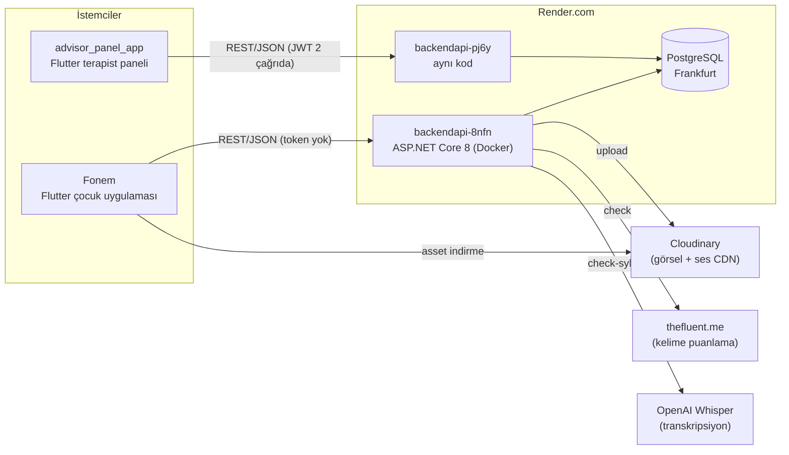
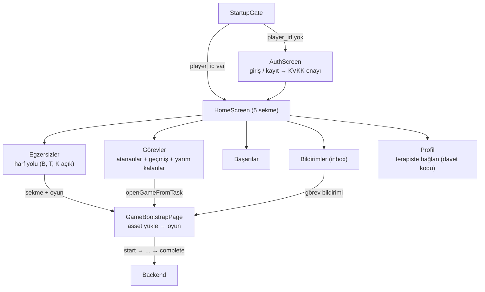
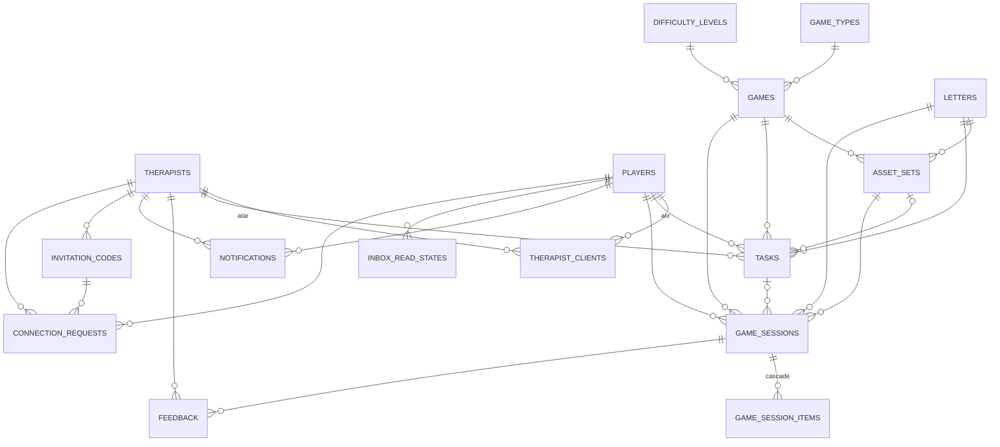
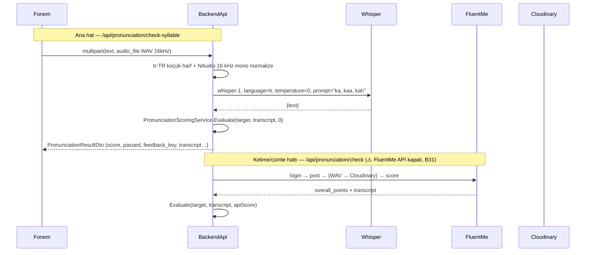
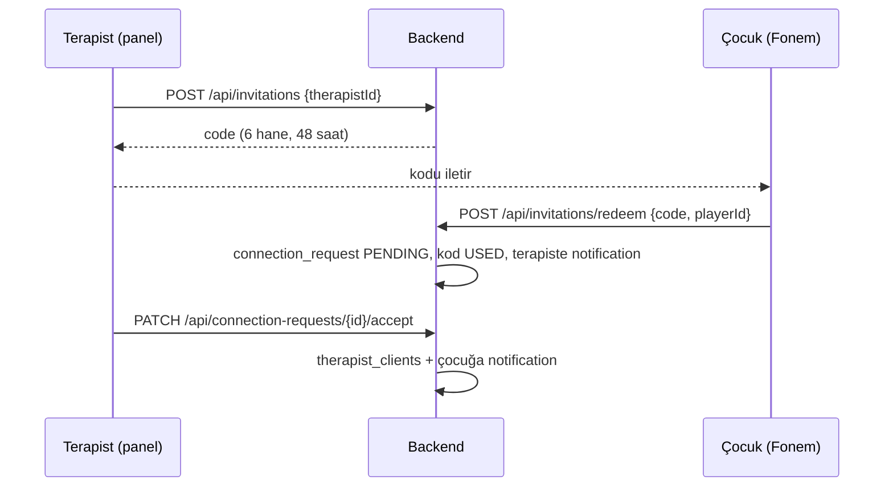
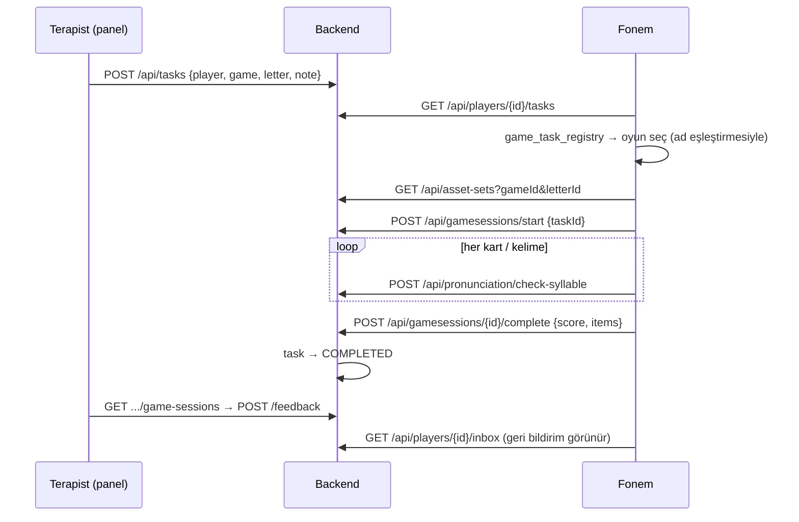

# ParroTalk — Sistem Mimarisi ve Çalışma Rehberi

> **Amaç:** Bu doküman, dil ve konuşma bozukluğu yaşayan çocuklar için geliştirilen ParroTalk sisteminin
> şu anki mimarisini, veri akışlarını, bilinen sorunlarını ve birlikte çalışırken uyacağımız kuralları anlatır.
> Yeni bir işe başlamadan önce ilgili bölümü okuyun; mimariyi değiştiren her PR'da bu dosyayı da güncelleyin.
>
> **Son inceleme:** 2026-10-16 · **İncelenen sürümler:** `Fonem@1ed3f6d`, `advisor_panel_app@6f90bbb`, `BackendApi@4b0ccc5`, `GraduationProject@873c283`
> **Son güncelleme:** 2026-10-16 — `BackendApi@d9f3992` (PR-29), `Fonem@3292474` (PR-23a), `advisor_panel_app@3f2738c` (PR-23b)
>
> İş planı ve PR sırası için: **[ROADMAP.md](ROADMAP.md)**

---

## İçindekiler

1. [Ürün Özeti](#1-ürün-özeti)
2. [Sistem Bağlamı](#2-sistem-bağlamı)
3. [Repolar ve Teknoloji Yığını](#3-repolar-ve-teknoloji-yığını)
4. [Fonem — Flutter Çocuk Uygulaması](#4-fonem--flutter-çocuk-uygulaması)
5. [advisor_panel_app — Flutter Terapist Paneli](#5-advisor_panel_app--flutter-terapist-paneli)
6. [Backend API](#6-backend-api)
7. [Uçtan Uca Akışlar](#7-uçtan-uca-akışlar)
8. [İstemci ↔ Backend Sözleşme Durumu](#8-i̇stemci--backend-sözleşme-durumu)
9. [Bilinen Riskler ve Teknik Borç](#9-bilinen-riskler-ve-teknik-borç)
10. [Çalışma Kuralları](#10-çalışma-kuralları)
11. [Önerilen Yol Haritası](#11-önerilen-yol-haritası)
12. [Açık Sorular ve Kararlar](#12-açık-sorular-ve-kararlar)
13. [Ek: Unity Demosu (gözden çıkarıldı)](#13-ek-unity-demosu-gözden-çıkarıldı)

---

## 1. Ürün Özeti

ParroTalk, artikülasyon/fonoloji terapisini oyunlaştıran bir sistemdir (hedef: 6 yaş üstü Türkçe konuşan çocuklar, ev + klinik kullanımı).

| Aktör | Uygulama | Ne yapar? |
|---|---|---|
| **Çocuk (Player / Danışan)** | **Fonem** — Flutter mobil (`bitirmesel/Fonem`) | Giriş/kayıt (KVKK onayı), harf yolu, hece/kelime/cümle oyunları, telaffuz değerlendirmesi, terapistin görevleri, gelen kutusu, başarılar, davet koduyla terapiste bağlanma. |
| **Terapist** | **advisor_panel_app** — Flutter (`bitirmesel/advisor_panel_app`) | Giriş, dashboard, danışan listesi, davet kodu, bağlantı isteklerini onaylama, görev atama, çocuğa mesaj, oturum geçmişi + geri bildirim, raporlar, profil. |
| **Sistem / Admin** | Swagger + Postman | Asset setlerini JSON olarak oluşturur, lookup tablolarını düzeltir, debug listelerini okur. |

> **Karar (2026-10-16):** Çocuk istemcisi **Fonem**dir. Unity (`GraduationProject`) Flutter'a geçmeden önceki **erken bir demoydu ve tamamen gözden çıkarıldı**: düzeltilmez, test edilmez, backend onunla uyumluluk gözetmez (bkz. [§13](#13-ek-unity-demosu-gözden-çıkarıldı)).

**Terapi içeriği modeli:** 20 Türkçe ünsüz (B, C, Ç, D … Z; `letters.id` 1–20) × oyun tipi (Hece / Kelime / Cümle) × zorluk (1-2-3) → 10 oyun ([§6.4](#64-oyun-kataloğu-gamesid)).
Her `(oyun, harf)` çifti için bir **AssetSet** (görseller, sesler, heceler) vardır.

---

## 2. Sistem Bağlamı



**Önemli gerçekler**

- Tüm iş mantığı **tek bir monolit backend**'dedir; istemciler "ince"dir.
- **Render'da aynı koddan iki servis, aynı veritabanı:** `pj6y` (`main`'den otomatik deploy) ve `8nfn` (deploy etmiyor). Aynı DB kullandıkları doğrulandı: `/api/tasks` iki serviste birebir aynı (2026-10-17). **2026-10-17'den beri (PR-12, FN#24)** Fonem REST çağrılarını `pj6y`'ye yapıyor. Telaffuz istekleri ise **geçici olarak `8nfn`'de**, çünkü `pj6y`'de `OPENAI_API_KEY` yok (B32). Terapist paneli zaten `pj6y`'de. Ortam değişkeni gerektiren her değişiklik, `8nfn` kapatılana kadar **iki servise de** uygulanmalı.
- ⚠️ **`8nfn` `main`'den otomatik deploy edilmiyor** (2026-10-16'da doğrulandı). Yeni Fonem sürümü yüklenene kadar cihazlardaki eski APK'lar `8nfn`'e gitmeye devam eder.
- Medya (görsel/ses) **Cloudinary**'de durur; veritabanında yalnızca URL parçaları (AssetSet JSON içinde) tutulur.
- **Tasarlanan telaffuz hattı:** hece oyunları (1-3) → **Whisper** (`check-syllable`); hece dışındaki tüm oyunlar (kelime, cümle) → **FluentMe** (`check`).
- ⚠️ **Bugün tüm oyunlar Whisper'da:** FluentMe çağrısı hata verdiği için Fonem Haziran 2026'da (`2408bb2`) kelime/cümle oyunlarını da geçici olarak `check-syllable`'a aldı. Koddaki yorum hatanın sebebini "backend token istiyor" diye açıklıyor, ama backend `/check` hiçbir zaman token istemedi; 401 FluentMe'nin kendi yanıtıydı. **2026-10-16 canlı testi:** `/check` iki serviste de 500; FluentMe giriş adresi (`thefluent.me/api/swagger/login`) **404 "Resource not found"**. thefluent.me sitesi Eylül 2026'da yenilenmiş, eski geliştirici API'si artık yok (RapidAPI üzerinden erişim doğrulanamadı). → [ROADMAP B31](ROADMAP.md#10-fark-edilenler-backlog)
- Render ücretsiz katmanı soğuk başlatma yapar; ilk istek 30-60 sn sürebilir.

---

## 3. Repolar ve Teknoloji Yığını

| | **Fonem** (çocuk) | **advisor_panel_app** (terapist) | **BackendApi** |
|---|---|---|---|
| Yerel klasör | `FlutterDemo/` | `advisor_panel_app/` | `BackendApi/` |
| Dil / Platform | Dart `^3.11.4`, Flutter | Dart `^3.7.2`, Flutter 3.29 | C# · .NET 8 Minimal API + 2 Controller |
| Durum yönetimi | `setState` + controller/mixin | `setState` | — |
| HTTP | `http` (sarmalayıcı `ApiClient`; PR-08 ile pubspec'te bildirildi) | `http` (doğrudan çağrılar) | — |
| Ses | `record` (WAV 16 kHz mono), `audioplayers` | — | NAudio |
| Depolama | `shared_preferences` | `shared_preferences` | PostgreSQL (EF Core 8) |
| Base URL | `--dart-define=API_BASE_URL`, varsayılan `pj6y`; telaffuz `PRONUNCIATION_BASE_URL`, varsayılan `8nfn` (geçici, B32) | sabit `pj6y` (`api_config.dart`) | — |
| App id | `com.example.flutter_demo` ⚠️ | `com.example.advisor_panel_app` ⚠️ | — |
| Test | 21 birim testi (PR-04, PR-07) | 9 birim testi (PR-05, PR-10) | 20 birim testi (PR-16) |
| CI | ✅ analyze (hata + uyarı fatal) + test | ✅ analyze (hata + uyarı fatal) + test | ✅ GitHub Actions (build + test + docker) |

Ekip: 3 katkıcı. Fonem'de ~95 commit (2026-04 → 2026-06), panelde ~20 commit, backend'de ~110 commit.

---

## 4. Fonem — Flutter Çocuk Uygulaması

### 4.1 Klasör yapısı

```
lib/
├── main.dart                    hata yakalayıcılar, dikey kilit, _StartupGate (prefs'te player_id → Home, yoksa Auth)
├── core/                        app_api_config (base URL), tema, app_error (Türkçe hata mesajları),
│                                datetime_display (UTC), known_game_ids, letter_id_lookup (B=1…Z=20), turkish_case
├── services/                    api_client (Bearer destekli sarmalayıcı), auth_service, session_store,
│                                game_session_api (start/complete), fluentme_service (check + check-syllable),
│                                kayıt okuyucular (io/web), game_audio_service
├── features/
│   ├── auth/, kvkk/             giriş/kayıt sekmeleri, KVKK onay ekranı
│   ├── home/                    5 sekmeli kabuk + okunmamış rozeti
│   ├── exercises/               harf yolu → Hece / Kelime / Cümle sekmeleri → oyun başlatma
│   ├── games/                   asset_orchestrator, game_bootstrap_page, asset veri kaynağı/adaptör, domain modelleri
│   ├── missions/                görevler, oturum geçmişi, görev → oyun yönlendirme (game_task_registry)
│   ├── notifications/           gelen kutusu
│   ├── achievements/            tamamlanan oturumlardan istatistik
│   ├── profile/                 kişisel bilgi, davet koduyla terapiste bağlanma, yardım, bildirim ayarları, KVKK
│   └── pronunciation/           pronunciation_flow_controller (kayıt → değerlendirme)
├── shared/                      pronunciation_mixin + widget'lar, game_session_mixin + game_session_store (devam ettirme)
├── games/, screens/, controllers/   oyun ekranları ve kontrolcüleri
├── models/                      asset_set, game_asset, dto/auth_models, db/* (entity aynaları)
└── data/mock_asset_sets.dart    asset gelmezse hece yedeği
```

### 4.2 Ekran akışı



### 4.3 Oyunlar

| Sekme | Oyun | İçerik kaynağı | `games.id` |
|---|---|---|---|
| Hece | Hece S1/S2/S3 (`games/syllable/syllable_game_page.dart`): dinle → kaydet → Whisper puanı | `asset-sets`; yoksa yerel mock heceler | 1/2/3 |
| Kelime | Hafıza kartları (`screens/memory_game_screen.dart`) | `gameconfig`, olmazsa `asset-sets` | 4 |
| Kelime | Üçlü eşleştir (`screens/triple_match_screen.dart`) | 〃 | 5 |
| Kelime | Mesleği bul (`screens/profession_match_screen.dart`) — T harfinde kapalı | 〃 | 6 |
| Kelime | Gölgesini bul (`games/word/shadow_matcher_screen.dart`) | 〃 | 7 |
| Cümle | "Cümle Kur" manav (`games/sentence/sentence_game_page.dart`) | **sabit kodlu** 5 meyve + 2 yerel MP4 | 8 (yalnızca görevden) |
| Cümle | Hikâye kur (`screens/story_builder_screen.dart`) | **sabit kodlu** 3 sahne | 10 (yalnızca görevden) |
| — | Balığı Seç, Resimden Kelime, Eksik Kelime, Sesli Oku | "Yakında" | — |

- Açık harfler yalnızca **B, T, K** (`exercises_page.dart:28`); Cümle sekmesi tam da bu harflerde kilitli (`:31`) → pratikte hep kilitli.
- Seviye kilitleri "UI testi" için devre dışı (`exercises_page.dart:350`).

### 4.4 Mimari

- **Katmanlar** (özellik bazlı, gevşek): Sayfa → Repository (`XRepository(ApiClient())`, DI yok) → `ApiClient`. Oyun tarafında Orchestrator → Service → RemoteDataSource + Adapter.
- **Savunmacı parse:** Modeller hem camelCase hem snake_case anahtarları ve `data`/`items` sarmalayıcılarını deniyor.
- **Kimlik:** Giriş `playerId`, takma ad ve toplam skoru prefs'e yazar. "Oturum açık" = prefs'te `player_id` var. Backend token dönmediği için **hiç Bearer gönderilmez**; `ApiClient` token gelirse göndermeye hazır.
- **Oturum yaşam döngüsü:** `GameSessionMixin` → `POST /api/gamesessions/start` (görevden geldiyse `taskId`) → oyun → `POST /{id}/complete` (ortalama skor, `maxScore=100`, item bazında sonuçlar). İlerleme yerelde saklanır (`GameSessionStore`), `/progress` çağrılmaz.

### 4.5 Ses ve telaffuz hattı

1. `record` → WAV, 16 kHz, mono, geçici `.wav` dosyası (basılı tut → kaydet, bırak → değerlendir).
2. Multipart `POST /api/pronunciation/check-syllable`: `text` (Türkçe küçük harf) + `audio_file`.
3. Backend → Whisper → `PronunciationScoringService` → `PronunciationResultDto` (`score`, `passed`, `feedback_key`, `transcript`…). **Fonem bu snake_case DTO'yu doğru okuyor.**
4. Geçme kararı **tutarsız:** hece oyunu `passed` (backend eşiği 70) kullanıyor; diğer oyunlar `overallPoints >= passingScore` (70 veya 80) ile kendi eşiğini uyguluyor.
5. Web derlemesi `webm` yüklüyor; backend NAudio ile **yalnızca WAV** okuyabildiği için web'de değerlendirme 500 döner.

### 4.6 Ölü / sabit kodlu

- Ölü: ~~`api_service.dart`, `profile/pages/*`, `models/{models,user_model}.dart`, `db/{app_db_context,therapist_client}.dart`~~ → ✅ PR-23a'da silindi. Kalan: terapist tarafı davet/bağlantı metotları. `FluentMeService.checkPronunciation` şu an çağrılmıyor ama **ölü kod değil, silinmemeli**: kelime/cümle oyunlarının asıl hattı (B31).
- Sabit: harf ID eşlemesi, oyun ID'leri, açık harfler, bildirimler sayfasının **örnek veriyle açılması** (`notifications_page.dart:35`), bildirim ayarları yalnızca yerel.

---

## 5. advisor_panel_app — Flutter Terapist Paneli

### 5.1 Klasör yapısı

```
lib/
├── main.dart, theme_manager.dart     MaterialApp, adlandırılmış rotalar ('/', '/home', '/register', '/forgot_password')
├── models/                           dashboard_summary, game_session_detail (diğer her şey Map<String, dynamic>)
├── services/                         api_config (sabit base URL), auth, dashboard, game_session, notification,
│                                     report (diğerlerini tekrar ediyor), settings, student
└── screens/                          login, register, forgot_password (sahte), home (5 sekme + dashboard),
                                      students, connection_requests, student_detail, session_feedback, tasks,
                                      settings, edit_profile, reports/*; dashboard_screen.dart (ölü)
```

### 5.2 Ekran akışı

Login → Home (Dashboard · Öğrenciler · Görevler/Bildirim · Raporlar · Ayarlar)
- Öğrenciler → Bağlantı istekleri · Davet kodu · Öğrenci detayı (görevler, oyun geçmişi, mesaj gönder, görev ata) → Oturum detayı + geri bildirim
- Raporlar → Öğrenci seçimi → Öğrenci raporu → Oturum detayı
- Ayarlar → Profil düzenle · Şifre değiştir · Tema · Çıkış

### 5.3 Mimari

- `StatefulWidget` + `setState`; servisler her ekranda `new`'leniyor; bazı ekranlar doğrudan `http` çağırıyor (`student_detail_screen.dart`).
- Giriş `access_token`, `therapistId`, `savedName`'i SharedPreferences'a yazar. **JWT yalnızca 2 çağrıda** (dashboard, report) gönderiliyor; kimlik `therapistId` sorgu/body parametresiyle istemci tarafından bildiriliyor.
- Base URL sabit: `backendapi-pj6y.onrender.com` ([§2](#2-sistem-bağlamı)).

### 5.4 Çalışan / bozuk / sahte

- **Çalışıyor:** giriş, dashboard + haftalık grafik, öğrenci listesi, davet kodu, bağlantı onay/ret, görev atama, mesaj gönderme, oturum geçmişi + geri bildirim, terapist bildirimleri, profil/şifre, raporlar.
- **Bozuk:** **Kayıt her zaman 400** — panel `name` gönderiyor; backend `fullName`, `username`, `verifyPassword` bekliyor.
- **Sahte / sabit:** "Şifremi unuttum" backend çağırmadan başarı gösteriyor; raporlardaki "canlı seans" kartı tamamen demo verisi; `lastActive` boşsa "3 dk önce"; haftalık grafikte gün etiketleri yanlış (backend bugünle biten 7 gün dönüyor, panel 0. indeksi "Pzt" sayıyor). Bunları düzelten birleştirilmemiş bir dal var: `origin/fix/reports-timezone-and-sessions`.

---

## 6. Backend API

### 6.1 Katmanlar

```
BackendApi/
├── Program.cs                 DI, JWT, CORS, Swagger, otomatik migration, endpoint mapping
├── Endpoints/*.cs             Minimal API grupları (iş mantığının %90'ı, doğrudan DbContext ile)
├── Controllers/               GameConfigController, PronunciationController (MVC)
├── Services/                  CloudinaryService, WhisperService, PronunciationScoringService,
│                              GameService (+ Repository/GameRepository)
├── Models/Db/                 EF Core entity'leri + AppDbContext
├── Models/Auth, Models/Game   İstek/yanıt modelleri
├── Dtos/                      DTO'lar (Game, Player, Tasks, Therapist, Pronunciation)
├── Migrations/                EF Core migration'ları
├── .github/                   PR şablonu + CI (dotnet build, docker build)
└── Dockerfile                 Render deploy imajı
```

**Desen:** Pratikte "Endpoint → DbContext" (transaction script). Service/Repository katmanı yalnızca `gameconfig` için var.

### 6.2 Başlangıç (Program.cs)

1. Connection string: `ConnectionStrings:Pg` → yoksa `DATABASE_URL`.
2. DI: `GameRepository`, `GameService`, `CloudinaryService`, `JwtHelper`, `PronunciationScoringService`, `WhisperService` (Scoped).
3. CORS `AllowFlutter`: her origin/header/method serbest.
4. JWT Bearer şeması kayıtlı **ama hiçbir endpoint `RequireAuthorization()` kullanmıyor.**
5. Swagger her ortamda açık.
6. **Açılışta `db.Database.Migrate()`** çalışır.

> `main`'de sırlar hâlâ `appsettings.json` ve `PronunciationController.cs` içinde. Ortam değişkenine taşıyan değişiklik **PR-01**'de (Render erişimi bekliyor).

### 6.3 Veri modeli



| Tablo | Not |
|---|---|
| `therapists`, `players` | Şifreler **düz metin**. `players` kişisel/sağlık verisi içerir (doğum tarihi, tanı, veli telefonu, okul). |
| `therapist_clients` | Composite PK `(therapist_id, player_id)`. N-N ilişki. |
| `letters`, `game_types`, `difficulty_levels`, `games` | Lookup/katalog. `letters`: 20 ünsüz, ID 1–20. |
| `asset_sets` | `(game_id, letter_id)` **unique**. İçerik `asset_json` (text) kolonunda serbest JSON. Zorluk ayrı kolon değil; oyun ID'sine gömülü. |
| `tasks` | `ASSIGNED` → `COMPLETED` (oturum tamamlanınca). |
| `game_sessions` + `game_session_items` | Oturum skoru + item bazında detay (`item_type`: WORD/SYLLABLE/SENTENCE/PHONEME/MATCH). |
| `feedback` | Terapistin oturuma yorumu (`rating` sunucuda sabit 5). |
| `notifications` | Terapist→çocuk (ve davet akışında çocuk→terapist) mesajları; `is_read`. |
| `inbox_read_states` | Birleşik gelen kutusu için okundu bilgisi; `source_type`: task / feedback / notification. |
| `invitation_codes` | 6 karakter, 48 saat geçerli. `PENDING → USED / EXPIRED / CANCELLED`. Terapist başına en fazla 10 PENDING. |
| `connection_requests` | `PENDING → ACCEPTED / REJECTED`. Kabulde `therapist_clients`'a satır eklenir. |

### 6.4 Oyun kataloğu (`games.id`)

| ID | Tip | Zorluk | Ad | Fonem | Panel |
|---|---|---|---|---|---|
| 1 | Hece | 1 | Hece S1 - 2 Harfliler | ✅ | görev atanabilir |
| 2 | Hece | 2 | Hece S2 - 3 Harfliler | ✅ | 〃 |
| 3 | Hece | 3 | Hece S3 - 4 Harfliler | ✅ | 〃 |
| 4 | Kelime | 1 | Kelime S1 - Hafıza Kartı | ✅ | 〃 |
| 5 | Kelime | 2 | Kelime S2 - Üçlü Eşleştir | ✅ | 〃 |
| 6 | Kelime | 3 | Kelime S3 - Mesleği Bul | ✅ | 〃 |
| 7 | Kelime | 3 | Kelime S3 - Gölgesini Bul | ✅ | 〃 |
| 8 | Cümle | 1 | Cümle S1 - Cümle Kur! | ⚠️ sabit içerik, MP4 paketlenmemiş | 〃 |
| 9 | Cümle | 2 | Cümle S2 - Fill Gap | ⏳ "çok yakında" mesajı (oyun yok) | ⚠️ atanabiliyor → PR-28 |
| 10 | Cümle | 3 | Cümle S3 - Story | ✅ (sabit içerik) | 〃 |

> **Kural:** Oyun ID'leri Fonem (`known_game_ids.dart`, `game_task_registry.dart`), panel ve asset JSON'larında sabit kodlu. Bu tablo **tek doğru kaynak**tır; değişirse tüm tarafları birlikte güncelleyin.

### 6.5 AssetSet JSON şeması

`asset_sets.asset_json` serbest metindir; şema sözleşmeyle korunur. Veritabanındaki gerçek biçim **snake_case**'tir (Fonem doğruladı):

```json
{
  "config_id": "K_Kelime_Memory",
  "base_url": "https://res.cloudinary.com/<cloud>/image/upload/.../letters/K/kelime/memoryGame/",
  "audio_base_url": "https://res.cloudinary.com/<cloud>/video/upload/...",
  "items": [
    { "key": "background", "file": "background.png" },
    { "key": "kedi", "file": "kedi.png", "audio": "kedi.mp3" }
  ]
}
```

- Oyuna özel ek alanlar olabilir (ör. Mesleği Bul: `workplaceKey`, `workplaceFile`).
- `GET /api/asset-sets?gameId&letterId&includeJson=true` Fonem'in ana kaynağıdır (`assetJson` alanı).
- `GET /api/gameconfig/{gameId}/{letterId}` `asset_json`'ı `application/json` olarak döner (PR-22; önceden `text/plain` ve `gameId == 1` için sabit mock). Fonem kelime oyunları (4-7) bunu kullanır; başarısız olursa `asset-sets`'e düşer.
- Cloudinary klasör düzeni: `graduationProject/letters/{HARF}/{tip}/{oyun}/`, yüklenen sesler `game_audio/`, telaffuz kayıtları `pronunciation/`.

### 6.6 Endpoint kataloğu

Hiçbiri kimlik doğrulama istemez. **FN** = Fonem, **PN** = terapist paneli.

**Kimlik**

| Metot | Yol | Tüketici | Not |
|---|---|---|---|
| POST | `/api/auth/login` | PN | JWT döner |
| POST | `/api/auth/register` | PN | ⚠️ panelden her zaman 400 (alan uyuşmazlığı) |
| POST | `/api/player/auth/login` | FN | Token **dönmez** |
| POST | `/api/player/auth/register` | FN | |

**Danışan / Terapist**

| Metot | Yol | Tüketici | Not |
|---|---|---|---|
| GET/POST | `/api/students?therapistId=` | PN | Liste / yeni danışan |
| GET | `/api/students/{id}` | FN | Şifre alanı gizli (PR-02; ⚠️ `8nfn`'de henüz yayında değil) |
| PATCH | `/api/students/{id}`, `/api/players/{id}` | FN | Kısmi güncelleme |
| GET | `/api/players`, `/api/players/{id}/therapists` | FN (ikincisi) | İlki debug |
| GET/PUT | `/api/therapists/{id}`, `/api/therapists/{id}/password` | PN, FN (GET) | Şifre alanı gizli (PR-02; ⚠️ `8nfn`'de henüz yayında değil) |
| GET | `/api/dashboard/summary`, `/api/students/{id}/stats` | PN (ilki) | `stats.weeklyProgress` sabit dummy |

**Davet ve bağlantı**

| Metot | Yol | Tüketici | Not |
|---|---|---|---|
| POST/GET/DELETE | `/api/invitations` | PN (POST) | Kod üret / listele / iptal |
| POST | `/api/invitations/redeem` | FN | IP başına 10/dk (in-memory) |
| GET/PATCH | `/api/connection-requests`, `/{id}/accept`, `/{id}/reject` | PN | |

**Görev, bildirim, gelen kutusu**

| Metot | Yol | Tüketici | Not |
|---|---|---|---|
| POST | `/api/tasks` | PN | |
| GET | `/api/therapists/{id}/tasks` | — | |
| GET | `/api/therapists/{id}/notifications` | PN | Görevlerden üretilir; tüm öğrencilerin adlarını içerir. Fonem artık kullanmıyor (PR-07). ⚠️ Kimliksiz erişilebilir → PR-15 |
| GET | `/api/players/{id}/tasks` | FN, PN | `PlayerTaskDto`: oyun tipi + zorluk (PR-06); terapist bilgisi PR-06b'de |
| GET | `/api/players/{id}/tasks/active` | — | |
| POST/GET/DELETE | `/api/notifications…` | PN (POST), FN | POST entity'yi doğrudan bağlıyor (mass assignment) |
| POST | `/api/notifications/{id}/read` | FN | PR-09 öncesi FN bir yolda PATCH gönderiyordu (405) |
| GET/POST | `/api/players/{id}/inbox`, `/inbox/unread-count`, `/inbox/{type}/{id}/read`, `/inbox/read-all` | FN | |

**Oyun içeriği ve oturumlar**

| Metot | Yol | Tüketici | Not |
|---|---|---|---|
| GET | `/api/lookup/letters`, `/games`, `/gametypes`, `/difficultylevels` | PN | |
| GET | `/api/gameconfig/{gameId}/{letterId}` | FN | Mock kaldırıldı (PR-22) |
| GET | `/api/asset-sets`, `/api/tasks/{id}/asset-set` | FN | |
| POST/PUT | `/api/assets/create`, `/bulk-create`, `/{g}/{l}/json` | Admin | |
| POST | `/api/media/upload`, `/upload-audio` | Admin | |
| POST | `/api/gamesessions/start`, `/{id}/complete` | FN | complete → görev `COMPLETED` |
| POST | `/api/gamesessions/{id}/progress` | — | FN ilerlemeyi yerelde tutuyor |
| GET/POST | `/api/gamesessions/{id}`, `/{id}/feedback`, `/all`, `/api/therapists/{t}/players/{p}/game-sessions` | PN, FN | |
| POST | `/api/admin/fix-lookups-and-games` | Admin | Tek seferlik |

**Telaffuz**

| Metot | Yol | Motor | Tüketici |
|---|---|---|---|
| POST | `/api/pronunciation/check` (`text`, `audio_file`) | FluentMe | Tasarımda FN kelime/cümle oyunları; **şu an çalışmıyor** (FluentMe API'si kapalı), FN geçici olarak Whisper kullanıyor → B31 |
| POST | `/api/pronunciation/check-syllable` (`text`, `audio_file`) | Whisper | **FN — tüm oyunlar** |

### 6.7 Telaffuz değerlendirme hattı



**Puanlama kuralları** (`PronunciationScoringService`, Türkçe karakterler ASCII'ye indirgenerek karşılaştırılır):

| Durum | Puan | `feedback_key` |
|---|---|---|
| Transkript boş | 0 | `no_audio` |
| Tam eşleşme | 100 | `exact_match` |
| Uzatma varyantı (`aah` ~ `ah`) | 85 | `length_variant` |
| Biri diğerini içeriyor | 70 | `contains` |
| Hedef ≤ 3 karakter ve eşleşmiyor | 0 | `mismatch_short` |
| Diğer (uzun kelime) | API skoru (Whisper hattında **0**) | `api_score` |

Geçme eşiği backend'de **70**. Whisper hattında uzun ve tam eşleşmeyen kelimeler `api_score = 0` aldığı için **0 puan** alır.

> ⚠️ Normalize işlemi `ı→i`, `ş→s` vb. yapar: **"kız" = "kiz"**, **"şapka" = "sapka"**. Terapide /s/–/ş/ ayrımı hedefleniyorsa bu bilinçli bir karar olmalı ([§12](#12-açık-sorular-ve-kararlar)).

### 6.8 Migration'lar

- Şema ilk olarak EF dışında oluşturulmuş; `Baseline` migration'ı boş. Temiz bir DB'de tablolar oluşmaz (PR-03 çözecek).
- Sonraki migration'lar: `RefactorGameSessionAndAddItems`, `FixGameSessionItemsTable`, `AddInboxReadStates`, `AddInvitationAndConnectionRequest`.
- **Migration'lar açılışta otomatik çalışır** → hatalı bir migration production'ı ayağa kaldırmaz.

```bash
dotnet ef migrations add <Isim> --project DktApi.csproj
```

### 6.9 Dağıtım ve yapılandırma

- `Dockerfile` çok aşamalı (sdk:8.0 → aspnet:8.0), `ASPNETCORE_URLS=http://+:10000`. ⚠️ `appsettings.json` içindeki Kestrel 5194 tanımı bunu eziyor; Render portu otomatik bulduğu için çalışıyor.
- Render: `pj6y` `main`'e push ile yeniden deploy ediliyor (doğrulandı); **`8nfn` edilmiyor** (doğrulandı, 2026-10-16) → PR-12.
- CI: her PR'da `dotnet build` + `docker build`.

| Ortam değişkeni | Kullanan | Durum |
|---|---|---|
| `ConnectionStrings__Pg` / `DATABASE_URL` | Program.cs | ⚠️ `main`'de `appsettings*.json` içinde açık → PR-01 |
| `Jwt__Key` | JwtHelper | ⚠️ `main`'de varsayılan değer → PR-01 |
| `CLOUDINARY_CLOUD_NAME`, `_API_KEY`, `_API_SECRET` | CloudinaryService | ✅ env |
| `OPENAI_API_KEY` | WhisperService | ✅ env |
| `FluentMe__User/Password/ApiKey` | PronunciationController | ⚠️ `main`'de kod içinde → PR-01 |

---

## 7. Uçtan Uca Akışlar

### 7.1 Terapist ↔ çocuk bağlantısı (✅ uçtan uca çalışıyor)



Alternatif yol: Terapist `POST /api/students` ile çocuğu doğrudan oluşturur.

### 7.2 Görev → oyun → sonuç (✅ çalışıyor, ⚠️ yönlendirme hataları var)



Görev yanıtında oyun tipi ve zorluk olmadığı için Fonem oyunu adla eşleştiriyor: Hece S2/S3 görevleri **S1** açıyor, "Cümle S3 - Story" görevi **Cümle Kur**'u açıyor (bkz. [§9](#9-bilinen-riskler-ve-teknik-borç)).

---

## 8. İstemci ↔ Backend Sözleşme Durumu

| İstemci | Çağrı | Durum | Etki |
|---|---|---|---|
| PN | `POST /api/auth/register` | ✅ PR-10 (`fullName`, `username`, `verifyPassword`) | Kayıt çalışıyor; giriş kullanıcı adıyla da yapılabiliyor |
| PN | `GET /api/students` | ⚠️ `age`, `registeredAt` beklenir, dönmez | Boş gösterilir |
| PN | `GET /api/therapists/{id}` | ⚠️ `title` beklenir, yok | "Terapist" varsayılanı |
| PN | `GET /api/games`, `/api/letters` | ❌ yok (doğrusu `/api/lookup/...`) | Ölü kodda, etkisi yok |
| FN+PN | Base URL | ✅ İkisi de `pj6y` (FN#24); FN telaffuzu geçici olarak `8nfn` | `pj6y`'ye `OPENAI_API_KEY` eklenince telaffuz da taşınır (B32) |
| FN | `GET /api/players/{id}/tasks` | ✅ oyun tipi + zorluk (PR-06); ⏳ terapist PR-06b | Yönlendirme düzeldi (PR-07); profil kartındaki terapist PR-06b ile dolacak |
| FN | `POST /api/notifications/{id}/read` | ✅ PR-09 (önceden PATCH → 405) | — |
| FN | `GET /api/students/{id}` | ✅ PR-09 (önceden önce var olmayan `/api/players/{id}` deneniyordu) | — |
| FN | `GET /api/gameconfig/{g}/{l}` | ✅ `text/plain` ama geçerli JSON; `ApiClient` çözüyor (kelime oyunları 4-7) | Mock kaldırıldı, `application/json` (PR-22) |
| FN | `check-syllable` web (`webm`) | ❌ backend yalnızca WAV | Web'de değerlendirme 500 |
| FN | `check-syllable` mobil | ✅ | — |
| FN | `gamesessions/start` + `complete`, inbox, redeem, asset-sets | ✅ | — |

---

## 9. Bilinen Riskler ve Teknik Borç

> Bu liste mimari düzeyde özettir. PR'lar sırasında fark edilen tüm bulgular, öncelikleri ve bağlandıkları kartlarla birlikte [ROADMAP.md §10 Fark Edilenler (Backlog)](ROADMAP.md#10-fark-edilenler-backlog) bölümünde tutulur.

### P0 — Güvenlik ve gizlilik (çocuk sağlık verisi işleniyor)

1. **Sırlar git geçmişinde ve repolar public.** Production PostgreSQL şifresi, FluentMe bilgileri ve JWT anahtarı herkese açık. → PR-01 (koddan çıkarma) + ADIM 0 (yenileme, ertelendi).
2. **Kimlik doğrulama yok.** Hiçbir endpoint korunmuyor; istemciler kimliği `therapistId`/`playerId` parametresiyle kendileri bildiriyor (IDOR).
3. **Şifreler düz metin** (therapist + player). Tez raporu BCrypt ve RBAC olduğunu söylüyor; gerçekte yok. Panelin gizlilik metni de aynı yanlış iddiayı içeriyor.
4. ~~Şifre içeren yanıtlar~~ ve 5. ~~hata yanıtlarında iç detay~~ → ✅ PR-02 (`main`, `pj6y`). **⚠️ `8nfn` hâlâ eski sürümde** → Fonem kullanıcıları için risk sürüyor (PR-12).
6. ~~Fonem istek/yanıt gövdelerini logluyor~~ → ✅ PR-04.
7. **Panel "beni hatırla" seçeneğinde şifreyi düz metin SharedPreferences'ta saklıyor;** JWT de düz metin. Çıkış oturumu temizlemiyor.
8. Swagger prod'da açık, CORS tamamen açık.
9. KVKK: çocuk ses kayıtları Cloudinary `pronunciation/` klasöründe süresiz ve herkese açık URL ile tutuluyor; kayıtlar OpenAI'ye (ve eski hatta FluentMe'ye) gönderiliyor. Fonem'deki KVKK onayı yalnızca cihazda saklanıyor.
10. Android release derlemeleri debug anahtarıyla imzalanıyor; app id'ler `com.example.*`.

11. ~~Npgsql 8.0.2'de yüksek önemli SQL injection açığı (CVE-2024-32655)~~ → ✅ PR-29 (8.0.9). ⚠️ `8nfn` deploy etmediği için orada hâlâ açık (B1).

### P1 — İşlevsel kırıklar

1. ~~Panelden terapist kaydı imkânsız~~ → ✅ PR-10.
2. ~~Fonem görev yönlendirmesi~~ → ✅ PR-06 + PR-07. Kalan: Fill Gap atanabiliyor ama oyunu yok → PR-28.
2b. ~~`GET /api/players` 500~~ → ✅ PR-27 (`pj6y`; `8nfn` deploy etmiyor → B1).
3. ~~Cümle Kur MP4'leri paketlenmiyor~~ → ✅ PR-08.
4. Cümle sekmesi B, T, K'da kilitli: **bilinçli** ("henüz hazır değil"), hata değil. Görevden açılan Cümle Kur çalışıyor.
5. Geçme eşiği tutarsız (hece: backend `passed` 70; diğer oyunlar istemcide 70/80) → **karar** (Backlog B22).
6. Whisper hattında uzun ve tam eşleşmeyen kelimeler 0 puan alıyor (`api_score` = 0).
7. Panel haftalık grafik gün etiketleri yanlış; düzelten dal birleştirilmemiş.
8. Panel raporlarında sabit demo kartı ("canlı seans"); "şifremi unuttum" sahte başarı gösteriyor.
9. İki Render servisi → ortam ve deploy tutarsızlığı riski.
10. ~~Fonem `http` paketi bildirilmemiş~~ → ✅ PR-08.

### P2 — Kod kalitesi

- Testler başladı (Fonem 21, panel 9, backend 20) ve üç repoda da CI'da çalışıyor. Ekran/entegrasyon testi yok.
- Panel: servisler birbirini tekrar ediyor (`ReportService` ↔ diğerleri), `therapistId` okuma kodu ~12 kez kopyalanmış, N+1 istek (öğrenci seçimi), `mounted` kontrolsüz `setState`, dispose edilmeyen controller'lar, ~55 deprecated API kullanımı, `pubspec.lock` gitignore'da.
- Fonem: hece oyunu kayıt ve oturum mantığını ortak mixin'den kopyalamış; iki ayrı session store; çok sayıda ölü dosya.
- Backend: `Console.WriteLine` loglama, `DateTime.Now`/`UtcNow` karışık, endpoint'lerde tekrarlanan doğrulama. (Ölü kod PR-22'de temizlendi; `Models/FluentMe` PR-01 sonrasına → B29.)

---

## 10. Çalışma Kuralları

### 10.1 Branch, commit ve PR

> PR yaşam döngüsü, roller ve "Bitti" tanımı: [ROADMAP.md §1](ROADMAP.md#1-nasıl-çalışacağız).

- `main`'e doğrudan push yok. Her iş `feature/PR-XX-<kısa-ad>` veya `fix/PR-XX-<kısa-ad>` dalında, PR ile.
- Commit mesajı: `[PR-XX] <alan>: <ne yapıldı>`. `.` gibi boş mesajlar yok.
- Backend PR'ları CI'dan (build + docker) yeşil geçmeden merge edilmez. Her PR Claude code review'dan geçer.

### 10.2 API değişikliği protokolü

1. Önce bu dokümandaki §6.6 / §8 tablolarını güncelle.
2. Yanıt şeklini değiştiriyorsan **istemcileri kırma**: yalnızca yeni alan ekle veya yeni yol aç; eski alanı istemciler geçtikten sonra kaldır.
3. Etkilenen istemcileri (Fonem, panel) aynı PR serisinde güncelle ve PR'larda birbirine link ver.
4. Ortam değişkeni gerekiyorsa **iki Render servisine** de ekle.

### 10.3 Sır yönetimi

- Hiçbir şifre, anahtar veya connection string repoya girmez. Backend yerelde `dotnet user-secrets`, Render'da Environment; Flutter'da `--dart-define`.
- İstemci loglarına (debugPrint, print) istek/yanıt gövdesi yazılmaz.

### 10.4 Yeni oyun ekleme (Fonem)

1. Backend'de `games` ID'sini belirle ([§6.4](#64-oyun-kataloğu-gamesid)) ve her harf için `asset_sets` JSON'unu oluştur (`POST /api/assets/create`).
2. Fonem'de ekran + controller yaz; içeriği `asset-sets`'ten al.
3. `known_game_ids.dart` ve `game_task_registry.dart`'a ekle (görevden açılabilsin).
4. Oturum için `GameSessionMixin`'i, telaffuz için `PronunciationFlowController`'ı kullan (kopyalama yapma).
5. Bu dokümanı güncelle.

### 10.5 Yeni endpoint ekleme (Backend)

1. İlgili `Endpoints/<Alan>Endpoints.cs` dosyasına ekle (yeni alan ise yeni dosya + `Program.cs`'te `Map…`).
2. İstek/yanıt için `Dtos/<Alan>/` altında DTO kullan; **entity döndürme**.
3. `.WithTags(...)` ve `.WithName(...)` ver; kimlik gerekiyorsa `.RequireAuthorization()`.
4. Hata durumunda `ErrorLog.Log` ile logla, istemciye yalnızca hata kodu dön.
5. Şema değiştiyse migration ekle ve **production dışı** bir DB'de dene.

---

## 11. Önerilen Yol Haritası

> PR bazında adımlar, bağımlılıklar ve kabul kriterleri [ROADMAP.md](ROADMAP.md)'dedir.

| Faz | Hedef | Özet |
|---|---|---|
| **1 — Güvenlik** | Sızıntıyı durdur | Sırları env'e taşı, şifre ve hata detayı dönmesin, yerel dev DB, istemci loglarında şifre olmasın, panel şifre saklamasın. |
| **2 — Uçtan uca akış** | Tez demosu sorunsuz çalışsın | Görev yanıtına oyun tipi/zorluk, Fonem görev yönlendirmesi, Cümle oyunu varlıkları, tek geçme eşiği, panel kaydı, panel grafik/rapor düzeltmeleri. |
| **3 — Kimlik ve yetki** | Herkes yalnızca kendi verisini görsün | Şifre hash, oyuncu JWT'si, istemciler token göndersin, yetkilendirme + sahiplik. |
| **4 — Mühendislik altyapısı** | Güvenle hızlanmak | Backend testleri, Flutter CI + gerçek testler, loglama, ölü kod temizliği, app id/imzalama. |
| **5 — Ürün ve KVKK** | Terapötik değer | Ses kaydı saklama politikası, KVKK onayının backend'de tutulması, yeni oyunlar, tez raporunun güncellenmesi. |

---

## 12. Açık Sorular ve Kararlar

**Kararlar**

| Tarih | Karar |
|---|---|
| 2026-10-16 | Çocuk istemcisi **Fonem**; Unity yalnızca erken bir demoydu, tamamen gözden çıkarıldı. |
| 2026-10-16 | ADIM 0 (sır yenileme) ertelendi; PR-01 Render erişimi bekliyor. |

**Cevaplanan sorular (2026-10-16)**

- Flutter terapist paneli → `bitirmesel/advisor_panel_app` ([§5](#5-advisor_panel_app--flutter-terapist-paneli)).
- `asset_json` biçimi → snake_case (`base_url`).
- Harf ID'leri → 20 ünsüz, B=1 … Z=20.
- Canlı backend = `main` (`/api/assets/sets` canlıda da yok).

**Açık sorular**

1. ~~İki Render servisinden hangisi esas?~~ → **`pj6y`** (2026-10-17, PR-12). Aynı DB'yi kullandıkları doğrulandı; `main`'i yalnızca `pj6y` deploy ediyor. Kalan: `pj6y`'ye `OPENAI_API_KEY` eklemek ve `8nfn`'i kapatmak (Render erişimi).
2. *(Araştırıldı → [docs/research/telaffuz-altyapisi-2026-10.md](research/telaffuz-altyapisi-2026-10.md))* Kelime değerlendirmesi Whisper'da mı kalacak? Uzun kelimelerde `api_score = 0` sorunu nasıl çözülecek (Levenshtein benzerliği, FluentMe'ye geri dönüş)?
3. `ş/s`, `ç/c`, `ı/i` ayrımı terapötik olarak puanlamada korunmalı mı?
4. Kestrel 5194 tanımı yalnızca Development'a mı taşınmalı?
5. ~~Dokümanların yeri?~~ → **`BackendApi/docs/`** (2026-10-17). `GraduationProject` reposu arşiv sayılır, oraya commit atılmaz. Taşımadan önceki doküman geçmişi GraduationProject PR #1–#15'te.
6. Tez raporu (Ocak 2026 sürümü) Unity demosunu çocuk uygulaması, Flutter'ı terapist/veli uygulaması olarak, backend'i yer yer "Java Spring Boot" olarak anlatıyor. Final raporu bu dokümana göre güncellenmeli.
7. Çocuk hesabını kim açacak: çocuk kendisi mi (Fonem kayıt), yalnızca terapist mi?

---

## 13. Ek: Unity Demosu (gözden çıkarıldı)

> `bitirmesel/GraduationProject` reposundaki Unity 6 projesi, ekip Flutter'a (Fonem) geçmeden önceki **erken demodur**. Tamamen gözden çıkarılmıştır: hataları düzeltilmez, test edilmez, backend değişikliklerinde onunla uyumluluk gözetilmez. Dokümanlar 2026-10-17'de `BackendApi/docs/`'a taşındı; repo arşiv sayılır ve commit atılmaz.

Fonem'e taşınan fikirler: telaffuz geçme eşiği, hece kartı akışı (dinle → kaydet → puan), asset önbellekleme.
