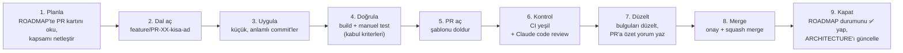
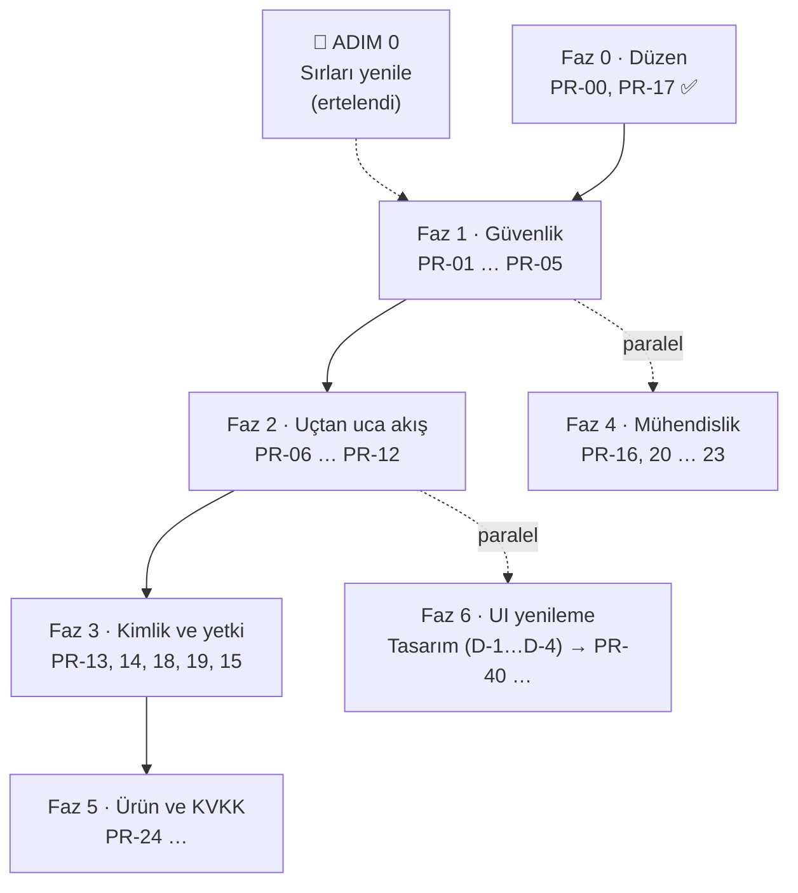

# ParroTalk — PR Yol Haritası

> Bu dosya [ARCHITECTURE.md](ARCHITECTURE.md)'deki bulguların **önceliklendirilmiş iş planıdır**.
> Her satır bir PR'dır. Durum değişiklikleri `docs/roadmap-durum` dalında toplanıp doküman PR'ıyla `main`'e alınır.
>
> **Repo kısaltmaları:** `BE` = [BackendApi](https://github.com/bitirmesel/BackendApi) · `FN` = [Fonem](https://github.com/bitirmesel/Fonem) (Flutter çocuk) · `PN` = [advisor_panel_app](https://github.com/bitirmesel/advisor_panel_app) (Flutter terapist) · `UN` = [GraduationProject](https://github.com/bitirmesel/GraduationProject) (Unity demosu, **arşiv**; commit atılmaz)
>
> **Bu dokümanların yeri:** `BackendApi/docs/` (2026-10-17'den beri). Doküman PR'ları BackendApi'ye açılır. Taşımadan önceki geçmiş GraduationProject PR #1–#15'te (`UN#…` bağlantıları).
>
> **Durum:** ⬜ başlamadı · 🔧 yapılıyor · 🟨 PR açık · ✅ merge edildi · ⏸️ beklemede · 🗑️ iptal

---

## 1. Nasıl çalışacağız?

### 1.1 Bir PR'ın yaşam döngüsü

Her adımda ne yaptığımızı açıkça yazarız: PR açıklamasında **Ne / Neden / Nasıl test edildi / Riskler** bölümleri zorunludur (bkz. `.github/pull_request_template.md`).

**Kontrol adımı:** CI'ı olan repolarda (şimdilik BE; FN ve PN için PR-20) GitHub Actions yeşil olmalı. Her PR Claude code review'dan geçer; bulgular PR'a satır içi yorum olarak yazılır, düzeltilenler ayrı bir yorumla özetlenir. Ertelenen bulgular ROADMAP'te ilgili karta not edilir.

### 1.2 Kurallar

| Kural | Açıklama |
|---|---|
| **`main`'e doğrudan push yok** | BE `main` = Render'a otomatik deploy edilen kod. Her değişiklik PR ile girer. GitHub'da branch protection açılması önerilir. |
| **Dal adı** | `feature/PR-07-gorev-yonlendirme`, `fix/PR-09-bildirim-post` — ROADMAP'teki ID ile başlar. |
| **PR başlığı** | `[PR-07] Fonem: görev yönlendirmesini oyun tipi ve zorlukla yap` |
| **Küçük PR** | Bir PR tek bir amaca hizmet eder; ~400 satırı geçiyorsa bölünür. |
| **Geriye uyumluluk** | BE merge'ü anında canlıya çıkar. BE PR'ı **kullanımdaki Fonem ve panel sürümlerini kırmamalı**: yeni alan ekle, eski alanı istemciler geçince kaldır. |
| **Çok repolu iş** | Her repo kendi PR'ını alır; açıklamalarda birbirine link verilir. Merge sırası kartta yazılıdır (genelde **BE önce**). |
| **İki Render servisi** | Ortam değişkeni gerektiren her BE PR'ında değişkenler **`8nfn` ve `pj6y` servislerinin ikisine de** eklenir (tek servise karar verilene kadar). |
| **Merge yöntemi** | Squash merge — `main` geçmişinde her PR tek commit olur. |
| **Tanım: Bitti** | Kabul kriterleri sağlandı + review onayı + ROADMAP/ARCHITECTURE güncellendi + (BE ise) canlıda Swagger'dan doğrulandı. |
| **Manuel adımlar** | 🔑 işaretli adımları (panel ayarları, şifre yenileme) yalnızca hesap sahibi yapar; PR açıklamasında "merge öncesi/sonrası yapılacaklar" olarak yazılır. |

### 1.3 Roller

- **Uygulayıcı** (Claude veya bir ekip üyesi): dalı açar, kodu yazar, kendi doğrulamasını yapar, PR'ı açar.
- **Reviewer** (ekip üyesi + Claude code review): kodu okur, kabul kriterlerini dener, onaylar.
- **Merge eden:** onaydan sonra PR sahibi veya reviewer. Claude merge etmez; yalnızca açıkça istenirse.

---

## 2. Genel Bakış

Faz 2, tez demosunda "çocuk oynar → terapist görür" akışını sorunsuz hale getirdiği için **en yüksek ürün değerine** sahiptir. Faz 1'in BE kısmı (PR-01, PR-02) ondan önce gelir, çünkü repolar herkese açık.

| ID | Faz | Repo | Başlık | Öncelik | Bağımlılık | Durum |
|---|---|---|---|---|---|---|
| ADIM 0 | 0 | 🔑 | Sızan sırları yenile (rotate) | **P0** | — | ⏸️ ertelendi (2026-10-16) |
| PR-00 | 0 | UN+BE | Mimari doküman, yol haritası, PR şablonu | P0 | — | ✅ [UN#1](https://github.com/bitirmesel/GraduationProject/pull/1) · [BE#1](https://github.com/bitirmesel/BackendApi/pull/1) |
| PR-17 | 0 | BE | GitHub Actions: build + docker (test adımı PR-16 ile) | P1 | — | ✅ [BE#3](https://github.com/bitirmesel/BackendApi/pull/3) |
| PR-01 | 1 | BE | Sırları koddan çıkar, ortam değişkenlerine taşı | **P0** | 🔑 Render env (iki servis) | ⏸️ [BE#2](https://github.com/bitirmesel/BackendApi/pull/2) draft — Render erişimi bekliyor |
| PR-02 | 1 | BE | Şifre alanı ve hata detayı sızıntısını durdur | **P0** | — | ✅ [BE#4](https://github.com/bitirmesel/BackendApi/pull/4) — `pj6y` yayında; ⚠️ `8nfn` deploy etmedi (PR-12) |
| PR-03 | 1 | BE | Yerel geliştirme veritabanı (docker-compose + şema + seed) | P0 | — | ⬜ |
| PR-04 | 1 | FN | İstek/yanıt gövdelerini loglamayı kaldır (şifre, kişisel veri) | **P0** | — | ✅ [FN#18](https://github.com/bitirmesel/Fonem/pull/18) |
| PR-05 | 1 | PN | Şifreyi cihazda saklama, çıkışta oturumu temizle | **P0** | — | ✅ [PN#2](https://github.com/bitirmesel/advisor_panel_app/pull/2) |
| PR-06 | 2 | BE | Görev yanıtına oyun tipi ve zorluk ekle | **P1** | — | ✅ [BE#5](https://github.com/bitirmesel/BackendApi/pull/5) |
| PR-06b | 2 | BE | Görev yanıtına terapist bilgisi ekle | P1 | ⛔ PR-07'li Fonem cihazlarda | 🟨 [BE#6](https://github.com/bitirmesel/BackendApi/pull/6) draft |
| PR-07 | 2 | FN | Görev yönlendirmesi: oyun ID/tip/zorlukla; Story/Fill Gap; inbox rozeti | **P1** | PR-06 | ✅ [FN#19](https://github.com/bitirmesel/Fonem/pull/19) |
| PR-08 | 2 | FN | Cümle Kur videolarını paketle; `http` bağımlılığı | **P1** | — | ✅ [FN#20](https://github.com/bitirmesel/Fonem/pull/20) |
| PR-09 | 2 | FN | Sözleşme düzeltmeleri: bildirim okundu POST, profil yolu | P1 | — | ✅ [FN#21](https://github.com/bitirmesel/Fonem/pull/21) |
| PR-10 | 2 | PN | Terapist kaydını düzelt (+ doğrulama, kullanıcı adıyla giriş) | **P1** | — | ✅ [PN#3](https://github.com/bitirmesel/advisor_panel_app/pull/3) |
| PR-11 | 2 | PN | Grafik gün etiketleri / saat dilimi; sahte "canlı seans" ve "şifremi unuttum" | P1 | — | ⬜ |
| PR-12 | 2 | BE+FN+PN | Tek backend servisi + `8nfn` deploy ayarı | **P0** ⬆️ | 🔑 karar + Render | ◐ Esas servis `pj6y`: ✅ [FN#24](https://github.com/bitirmesel/Fonem/pull/24). Kalan 🔑: `pj6y`'ye `OPENAI_API_KEY` (B32), `8nfn`'i kapat |
| PR-13 | 3 | BE | Şifre hash'leme (şeffaf geçiş) | P1 | PR-02 | ◐ ✅ [BE#13](https://github.com/bitirmesel/BackendApi/pull/13) hash + backfill (canlıda). Kalan **PR-13b**: düz metin sütununu temizle (hash'le giriş doğrulanınca; tercihen `8nfn` kapanınca) |
| PR-14 | 3 | BE | Oyuncu JWT'si + rol claim'leri | P1 | PR-13 | ⬜ |
| PR-18 | 3 | FN | Token'ı güvenli sakla ve her istekte gönder | P1 | PR-14 | ⬜ |
| PR-19 | 3 | PN | Token'ı güvenli sakla ve **her** istekte gönder | P1 | PR-14 | ⬜ |
| PR-15 | 3 | BE | Yetkilendirme + sahiplik + DTO'lar + Swagger | P1 | PR-18, PR-19 | ⬜ |
| PR-16 | 4 | BE | Test projesi + `PronunciationScoringService` testleri | P2 | — | ✅ [BE#8](https://github.com/bitirmesel/BackendApi/pull/8) (20 test, CI'da) |
| PR-20 | 4 | FN+PN | Flutter CI (`analyze` + `test`), bozuk şablon testlerini gerçek testlerle değiştir | P2 | — | ✅ [FN#22](https://github.com/bitirmesel/Fonem/pull/22) · [PN#4](https://github.com/bitirmesel/advisor_panel_app/pull/4) (CI'da 21 + 9 test) |
| PR-21 | 4 | BE | `ILogger`, global hata yakalama, UTC tutarlılığı | P2 | PR-02 | ⬜ |
| PR-22 | 4 | BE | Ölü kod temizliği (gameconfig mock, FluentMeService, Dapper, `Dtos.cs`) | P2 | PR-09 | ✅ [BE#9](https://github.com/bitirmesel/BackendApi/pull/9) (`Models/FluentMe` PR-01 sonrasına → B29) |
| PR-23 | 4 | FN+PN | Ölü kod/paket temizliği, gerçek app id, release imzası, repo hijyeni | P2 | — | ◐ temizlik: ✅ [FN#23](https://github.com/bitirmesel/Fonem/pull/23) · ✅ [PN#5](https://github.com/bitirmesel/advisor_panel_app/pull/5); app id + imza ⏸️ hesap sahibi |
| PR-24 | 5 | BE+FN | Ses kaydı saklama politikası + KVKK onayının backend'de tutulması | P1 | PR-15 | ⬜ |
| PR-25+ | 5 | FN+BE | Yeni oyunlar ve gerçek içerik (Cümle S1-S3, "Yakında" oyunlar) | P2 | PR-07 | ⬜ |
| PR-26 | 5 | UN | Unity reposunu GitHub'da arşivle | P2 | ✅ dokümanlar taşındı | ⏸️ 🔑 hesap sahibi: GitHub → Settings → Archive this repository (commit gerekmez) |
| PR-27 | 2 | BE | `GET /api/players` 500 hatası (NULL alanlı oyuncu kaydı) | P1 | — | ✅ [BE#7](https://github.com/bitirmesel/BackendApi/pull/7) (`pj6y`'de doğrulandı) |
| PR-28 | 2 | PN+BE | Oynanamayan oyun/harf (Fill Gap, içeriksiz harf) görev olarak atanamasın | P1 | — | ✅ [BE#11](https://github.com/bitirmesel/BackendApi/pull/11) · [PN#6](https://github.com/bitirmesel/advisor_panel_app/pull/6) (canlıda doğrulandı) |
| PR-29 | 1 | BE | Npgsql güvenlik açığı CVE-2024-32655 (8.0.2 → 8.0.9) | **P0** | — | ✅ [BE#10](https://github.com/bitirmesel/BackendApi/pull/10) |
| D-1…D-4 | 6 | — | **UI tasarımı** (kod yok): referanslar → tasarım ilkeleri ve sistem → sayfa sayfa mockup (yan panel) → onay | P1 | — | ⬜ referanslar bekleniyor |
| PR-40 | 6 | FN | Tasarım sistemi: tema, renk/tipografi token'ları, ortak bileşenler | P1 | D-4 | ⬜ |
| PR-41+ | 6 | FN | Ekran ekran yeni UI (giriş + **giriş kodu** ekranı, harf haritası, görevler, oyun kabuğu, ödül/profil) | P1 | PR-40, PR-14 | ⬜ |
| PR-45+ | 6 | PN | Terapist paneli UI (Fonem'den sonra) | P2 | PR-40 | ⬜ |
| — | — | UN | ~~Unity: telaffuz DTO, oturum kaydı, LevelMap, hece oyunu, küçük düzeltmeler, token, davet ekranı~~ | — | — | 🗑️ Unity yalnızca demoydu, gözden çıkarıldı (2026-10-16) |

---

## 3. Faz 0 — Düzen ve acil müdahale

### ADIM 0 · 🔑 Sızan sırları yenile (PR değil) — ⏸️ ertelendi

> Repolar **public**; git geçmişindeki şifreler kod silinse de okunabilir. Tek kalıcı çözüm şifreleri geçersiz kılmaktır.

1. **Render → PostgreSQL:** veritabanı kullanıcısının şifresini yenile, yeni connection string'i al.
2. **Render → her iki web servisi (`8nfn`, `pj6y`) → Environment:** `ConnectionStrings__Pg` = yeni connection string.
3. **thefluent.me:** hesap şifresini değiştir, API anahtarını yenile; Render'da `FluentMe__*` değerlerini güncelle.
4. **JWT:** `openssl rand -base64 48` ile yeni anahtar → `Jwt__Key`.

PR-01 merge edildikten sonra yenileme yalnızca Render'daki değerleri değiştirmekten ibarettir; kod değişikliği gerekmez.

### PR-00 · ✅ · PR-17 · ✅

Doküman + PR şablonları ve backend CI (`dotnet build` + `docker build`) `main`'de.
**🔑 Önerilen:** GitHub → Settings → Branches → `main` için *Require a pull request* + *Require status checks* (BE: `dotnet build`, `docker build`).

---

## 4. Faz 1 — Güvenlik

### PR-01 · BE · Sırları koddan çıkar — ⏸️ BE#2 (draft)

Kod hazır, review'dan geçti. **Merge ön koşulu 🔑:** Render'da **iki servise de** `ConnectionStrings__Pg`, `Jwt__Key`, `FluentMe__User`, `FluentMe__Password`, `FluentMe__ApiKey`. Şifre yenileme gerekmez; mevcut değerler girilebilir. Ayrıntılar PR açıklamasında.

### PR-02 · BE · Şifre alanı ve hata detayı sızıntısı — ✅ BE#4

> Review'da ek olarak: FluentMe post hatasında ham yanıt sızıntısı ve boş `catch` blokları (accept/reject/redeem) düzeltildi. **Canlı durum:** `pj6y` yayına aldı; `8nfn` almadı (bkz. PR-12).

1. `Player.Password` ve `Therapist.Password` → `[JsonIgnore]`. Şifre hiçbir JSON yanıtına yazılmaz; diğer alan adları aynı kalır. Fonem ve panel uyumluluğu doğrulandı. Tam DTO'ya geçiş PR-15'te.
2. `GET /api/students` stack trace dönüşü kaldırıldı.
3. `ex.Message` / inner exception / dış servis gövdesi dönen 7 nokta → genel mesaj + kısa **hata kodu** (`ErrorLog.Log`); detay yalnızca loglanır.

**Kapsam dışı:** Swagger'ı prod'da kapatmak → PR-15.

### PR-03 · BE · Yerel geliştirme veritabanı

1. `docker-compose.yml`: PostgreSQL 16.
2. Baseline migration boş olduğu için prod şemasının SQL'i (`pg_dump --schema-only`) repoya eklenir; temiz DB'de baştan kurulum sağlanır.
3. Seed: `letters` (20 ünsüz), `game_types`, `difficulty_levels`, `games` (1-10), örnek `asset_sets`.
4. README: "5 dakikada yerel kurulum". Fonem `--dart-define=API_BASE_URL=http://10.0.2.2:5194` ile yerel backend'e bağlanabilir.

**Kabul:** `docker compose up -d` + `dotnet run` ile prod'a dokunmadan Swagger ve Fonem çalışıyor.

### PR-04 · FN · Loglarda şifre ve kişisel veri olmasın — ✅ FN#18

> Review sonrası kapsam genişledi: 13 catch bloğu `logError`'a yönlendirildi, `FluentMeService` artık gövdeli `Exception` yerine `ApiHttpException` fırlatıyor. Release'de log = tip + HTTP durum kodu. Cihazda `adb logcat` kontrolü yapılmadı.

1. `services/api_client.dart`: istek ve yanıt **gövdelerinin** `debugPrint`'ini kaldır. Yalnızca yöntem, yol ve durum kodu loglansın; o da yalnızca `kDebugMode`'da.
2. Diğer dosyalardaki kişisel veri logları (profil, giriş) temizlenir.

**Kabul:** Release derlemesinde giriş yaparken logcat'te şifre veya profil verisi görünmüyor.

### PR-05 · PN · Şifreyi cihazda saklama, çıkışı düzelt

1. "Beni hatırla" yalnızca e-postayı hatırlasın; **şifre saklanmasın** (`auth_service.dart`).
2. Çıkış: token, `therapistId`, ad ve kayıtlı bilgiler temizlensin (`settings_screen.dart`).
3. Giriş/kayıt formunda şifre **kırpılmasın** (`trim` yalnızca e-postada).
4. Ayarlar → gizlilik metnindeki "şifreniz sunucuda hash'lenir" ifadesi PR-13'e kadar kaldırılsın (yanlış bilgi).

---

## 5. Faz 2 — Uçtan uca akış (tez demosu için kritik)

### PR-06 · BE · Görev yanıtını zenginleştir — ✅ BE#5

İki endpoint ortak `PlayerTaskDto`'yu paylaşıyor: `gameTypeCode`, `difficultyLevel`, iç içe `game {gameType{code}, difficultyLevel{level}}`. Eski alanlar korundu.

> **Review'da kapsam değişti:** `therapistId` bilerek çıkarıldı. Eski Fonem, `therapistId > 0` görünce terapistin **tüm öğrencilerinin** bildirim akışını (çocuk adlarıyla) rozet ve yedek listede kullanıyordu → PR-06b'ye ayrıldı.

### PR-06b · BE · Görev yanıtına terapist bilgisi — 🟨 BE#6 (draft)

`therapistId`, `therapistName`, `therapist {id, name, clinicName}` (e-posta/telefon yok). Fonem profil kartı ve görev kartı bu alanlarla doluyor (bugün boş).
**⛔ Merge koşulu:** PR-07'yi (FN#19) içeren Fonem sürümü test cihazlarına yüklenmiş olmalı; backend değişikliği eski sürümleri anında etkiler.

### PR-07 · FN · Görev yönlendirmesi — ✅ FN#19

> Yapılan: `resolveTaskGameKind` (önce `KnownGameIds` kataloğu, sonra tip kodu, sonra ad), hece seviyesi `gameId`'den, Story/Fill Gap düzeltildi, kategori düzeyindeki `SENTENCE` eşlemesi kaldırıldı. Rozet ve yedek liste çocuğun kendi inbox'ından; terapist akışı Fonem'den tamamen çıktı. Sahte bildirim verisi ve null-assert çökme riski kaldırıldı. 19 birim testi. Cihazda uçtan uca denenmedi.

1. `game_task_registry.dart`: önce **`gameId`** ile eşle (1-10 tablosu), ad eşleştirmesi yalnızca yedek.
2. Hece görevleri doğru seviyeyi açsın (S2/S3 → gameId 2/3 içerik ve oturum).
3. "Cümle S3 - Story" → hikâye oyunu; "Cümle S2 - Fill Gap" → "Yakında" ekranı (yanlış oyun açılmasın).
4. Okunmamış rozeti ve çocuğun bildirimleri: **terapist bildirim akışı yerine** `GET /api/players/{id}/inbox/unread-count` ve `/inbox` kullanılsın (gizlilik: çocuk diğer öğrencilerin olaylarını görmemeli).
5. Bildirimler sayfası örnek veriyle açılmasın; hata durumunda örnek veri yerine hata görünümü gösterilsin.

**Kabul:** Panelden atanan her oyun tipi Fonem'de doğru oyunu ve seviyeyi açıyor; tamamlanınca panelde COMPLETED görünüyor.

### PR-08 · FN · Cümle oyunu ve geçme eşiği — ✅ FN#20 (kapsam daraldı)

> Yapılan: iki MP4 `pubspec.yaml`'a eklendi (`flutter build bundle` ile doğrulandı), `http`/`http_parser` doğrudan bağımlılık. **Yapılmayan (bilinçli):** madde 3 (tek eşik) → oyunlar farklı eşikleri bilerek kullanıyor gibi; zorluğu değiştirir → **Backlog B22 (karar)**. Madde 4 (Cümle sekmesi kilidi) → kodda bilinçli işaretli ("henüz hazır değil"), hata değil.

1. `pubspec.yaml`'a `assets/manavgamebackground.mp4` ve `assets/manav_video.mp4` eklensin; kullanılmayan gölge PNG'leri kontrol edilsin.
2. `http` ve `http_parser` doğrudan bağımlılık olarak eklensin.
3. Geçme kararı tek yerde: tüm oyunlar backend'in `passed` alanını kullansın (istemcideki 70/80/85 eşikleri kaldırılsın).
4. Cümle sekmesi kilidi (`exercises_page.dart:31`) mantığı düzeltilsin.

### PR-09 · FN · Sözleşme düzeltmeleri — ✅ FN#21

> Yapılan: madde 1 ve 2 (canlıda yan etkisiz isteklerle doğrulandı: eski yollar 405). **Madde 3 geçersizdi:** `gameconfig` `text/plain` dönse de içerik geçerli JSON ve `ApiClient` çözüyor; kelime oyunları için ilk istek başarılı, çift çağrı yok. Madde 4 (web webm) → Backlog B17.

1. `notifications_repository.dart`: `PATCH /api/notifications/{id}/read` → **POST**.
2. `player_repository.dart`: önce olmayan `GET /api/players/{id}`'yi denemesin; doğrudan `/api/students/{id}`.
3. Asset yükleme: `gameconfig` denemesini kaldırıp doğrudan `asset-sets` kullansın (çift çağrı biter; BE'deki gameId=1 mock'u PR-22'de silinir).
4. Web derlemesi: kayıt WAV değilse değerlendirmeyi engelleyip açık mesaj göster (ya da BE'ye webm desteği, ayrı karar).

### PR-10 · PN · Terapist kaydı

1. `auth_service.dart` register: `fullName`, `username`, `email`, `password`, `verifyPassword`, `clinicName` gönderilsin; formda kullanıcı adı ve şifre tekrarı alanı.
2. E-posta biçimi ve şifre uzunluğu (≥ 6) istemcide doğrulansın.
3. Başarılı kayıtta doğrudan giriş yapılsın.

**Kabul:** Yeni terapist panelden kayıt olup giriş yapabiliyor.

### PR-11 · PN · Raporlar ve dashboard doğruluğu

1. Birleştirilmemiş `origin/fix/reports-timezone-and-sessions` dalı incelenip uygun kısımları alınsın (grafik gün tekrarı, saat dilimi, gerçek seans listesi).
2. Haftalık grafik etiketleri backend'in `day` alanından gelsin.
3. Raporlardaki sabit "canlı seans" demo kartı kaldırılsın.
4. "Şifremi unuttum": sahte başarı yerine "Terapistinize/yöneticiye başvurun" bilgisi (gerçek akış ayrı iş).
5. `lastActive` boşken "3 dk önce" yerine "—".
6. (Backlog B15) `/api/students` `age`/`registeredAt`, terapist `title`, `stats.weeklyProgress` dummy verisi, terapist bildirimlerinde hep `unread = true` ve `markAsRead` TODO: ya backend'e eklenir ya da panelde gösterilmez.

### PR-12 · BE+FN+PN · Tek backend servisi — ⏸️ Render erişimi bekliyor

> ⬆️ **Öncelik P0'a yükseldi (2026-10-16):** PR-02 merge edildikten 30+ dakika sonra `pj6y` şifre alanını gizliyor, **Fonem'in bağlandığı `8nfn` hâlâ şifre dönüyor** → `8nfn` `main`'den otomatik deploy edilmiyor. Render'da ilk iş: `8nfn`'in bağlı olduğu repo/dal ve auto-deploy ayarını kontrol et, manuel deploy et. İstemciyi `pj6y`'ye çevirmek tek başına yetmez; `8nfn` açık kaldıkça doğrudan erişilebilir.

Karar sonrası: istemcilerin base URL'i tek servise çevrilir, diğer servis kapatılır. FN'de `--dart-define` zaten var; PN'de `api_config.dart` dart-define destekleyecek şekilde değişir.

---

## 6. Faz 3 — Kimlik ve yetki

> **Tasarım ve yayın sırası:** [docs/design/faz3-kimlik-ve-yetki.md](design/faz3-kimlik-ve-yetki.md) (taslak, onay bekliyor). PR-15 orada 15a (gözlem) ve 15b (zorlama) olarak ikiye bölünüyor.

> **Strateji:** Kırıcı değişiklik üç adımda → (1) backend token üretir, (2) istemciler token gönderir, (3) backend zorunlu kılar. Hiçbir anda canlı uygulama kırılmaz.

### PR-13 · BE · Şifre hash'leme
ASP.NET `PasswordHasher<T>`. **Şeffaf geçiş:** girişte kayıtlı şifre hash değilse düz metinle karşılaştır, başarılıysa hash'leyip kaydet. Kayıt, şifre değiştirme ve PATCH yolları hash yazar.

### PR-14 · BE · Oyuncu JWT'si
`/api/player/auth/login` yanıtına `token` (`role=player`, `playerId`); mevcut alanlar korunur. Terapist token'ında `role=therapist` zaten var.

### PR-18 · FN / PR-19 · PN · Token gönderimi
Token `flutter_secure_storage`'da saklanır, **her** isteğe `Authorization: Bearer` eklenir, `401`'de girişe dönülür. FN'de `ApiClient` hazır; PN'de tüm servisler tek bir HTTP istemcisine toplanır.

### PR-15 · BE · Yetkilendirme
- Endpoint grupları `MapGroup` ile toplanır, `.RequireAuthorization("therapist" | "player")`.
- **Sahiplik:** terapist yalnızca `therapist_clients`'taki çocukları, oyuncu yalnızca kendi verisini görür; `therapistId`/`playerId` token'dan okunur.
- Açık kalanlar: login/register, lookup, `invitations/redeem` (oyuncu token'ı ile).
- Debug endpoint'leri (`/api/players`, `/api/tasks`, `/api/gamesessions/all`, `/api/admin/*`) `admin` rolüne veya yalnızca Development'a.
- (Backlog B4) `/api/therapists/{id}/notifications` yalnızca o terapistin token'ıyla erişilebilir olsun (bugün herkes, tüm öğrencilerin adlarıyla okuyabiliyor).
- Swagger: prod'da `admin` rolüne veya `ENABLE_SWAGGER=true`'ya bağlanır (PR-02'den taşındı).
- Entity dönen endpoint'ler (`/students/{id}`, `/therapists/{id}`, `POST /notifications`) DTO'ya çevrilir.

**Kabul:** Token'sız istek `401`, başkasının verisi `403`.

---

## 7. Faz 4 — Mühendislik altyapısı (Faz 1'den sonra paralel yürüyebilir)

| PR | İçerik | Kabul |
|---|---|---|
| **PR-16** BE | `tests/DktApi.Tests` (xUnit): `PronunciationScoringService` tablo testleri (`exact_match`, `length_variant`, Türkçe karakterler, Whisper hattında uzun kelime = 0). ⚠️ Kökteki `DktApi.csproj` tüm alt klasörleri derler: `<Compile Remove="tests/**" />` eklenmeli. CI'a `dotnet test` adımı. | `dotnet test` yeşil, CI'da çalışıyor |
| **PR-20** FN+PN | `.github/workflows/flutter-ci.yml`: `flutter analyze` + `flutter test`. Bozuk sayaç şablon testleri silinip model/parse testleri eklenir (ör. `PronunciationResultDto`, görev → oyun eşlemesi). | PR'larda yeşil tik |
| **PR-21** BE | `Console.WriteLine` → `ILogger`; `UseExceptionHandler` + ProblemDetails; `DateTime.Now` → `UtcNow`. | Loglar seviyeli; 500'ler tek biçimde |
| **PR-22** BE | `GameConfigController` mock'u, `FluentMeService`, Dapper paketi, csproj'daki yorum bloğu, `Dtos.cs`; Kestrel 5194'ü Development'a taşı (karara bağlı). | Build temiz, davranış aynı |
| **PR-23** FN+PN | Ölü dosyalar ve kullanılmayan paketler; `com.example.*` → gerçek app id; release imzası; PN'de `pubspec.lock` takibi, `.idea/` ve `android.zip` temizliği, `.gitignore` düzeltmesi (`*.swift` vb. hariç tutulmasın); deprecated API'ler. | Uygulamalar aynı çalışıyor, analyze uyarıları düştü |

---

## 8. Faz 5 — Ürün ve KVKK

| PR | İçerik |
|---|---|
| **PR-24** BE+FN | Değerlendirme sonrası Cloudinary kayıtları silinsin (veya private teslimat); Fonem'in KVKK onayı backend'e kaydedilsin (`players.guardian_consent_at`); aydınlatma metni sürümü. |
| **PR-25+** | Her yeni oyun için ayrı PR: içerik (asset JSON) + Fonem ekranı + `game_task_registry`. Sıra önerisi: Cümle S1 gerçek içerik → Cümle S2 Fill Gap → Cümle S3 Story (asset'ten). Açık harflerin (B, T, K) genişletilmesi içerik hazır oldukça. |
| **PR-26** UN | Dokümanlar yeni yerine taşındıktan sonra: Unity demosu repodan kaldırılır ya da repo README notuyla ("erken demo, Fonem'e taşındı") GitHub'da arşivlenir. Dokümanlar 2026-10-17'de `BackendApi/docs/`'a taşındı; geriye yalnızca GitHub'da arşivleme kaldı (ekip kararı: oraya commit atılmıyor). |
| **Tez** | Final raporu güncellenmeli: çocuk = Fonem (Flutter), terapist = advisor_panel_app, backend = .NET (Java/Spring ifadeleri), Whisper hattı, güvenlik iddiaları (BCrypt/RBAC) yalnızca PR-13/PR-15 sonrası. |

**Bekleyen kararlar:** tek backend servisi (PR-12) · Kestrel portu · `ş/s`, `ç/c`, `ı/i` ayrımı · uzun kelimelerde Whisper puanlaması. Bkz. [ARCHITECTURE §12](ARCHITECTURE.md#12-açık-sorular-ve-kararlar).

---

## 8b. Faz 6 — UI yenileme (önce Fonem)

> **Neden:** Proje startup olarak sürecek; mevcut arayüz, özellikle çocuk uygulamasında yeterli değil (ekip kararı, 2026-10-17).
> **Yöntem:** Önce tasarım, sonra kod. Tasarım aşaması uygulama koduna dokunmaz; bu yüzden Faz 3'le **paralel** yürür.

| Adım | İçerik | Çıktı |
|---|---|---|
| **D-1** Referanslar | Ekip beğendiği UI örneklerini paylaşır; neyin neden beğenildiği not edilir | Referans panosu |
| **D-2** İlkeler ve tasarım sistemi | Hedef kitle: 3-8 yaş, çoğu okuma bilmiyor → büyük dokunma alanları, az metin, sesli/görsel yönlendirme, tutarlı karakter/maskot, ödül dili. Renk, tipografi, köşe, gölge, ikon, animasyon kuralları | `docs/design/ui/` + yan panelde canlı stil sayfası |
| **D-3** Sayfa mockup'ları | Her ekran için 2-3 seçenek, yan panelde (HTML/Flutter web) tıklanabilir prototip. Sıra: giriş + giriş kodu → harf haritası → görevler → oyun kabuğu (üst bar, ilerleme, telaffuz düğmesi, sonuç) → ödül/profil | Seçilen seçenekler |
| **D-4** Onay | Tüm ekranlar kararlaştırılır, akış baştan sona prototipte denenir | Onaylı tasarım |
| **PR-40** | Tasarım sistemi kodda: `ThemeData`, token'lar, ortak bileşenler (düğme, kart, mikrofon, ilerleme) | Mevcut ekranlar yeni temayı alır |
| **PR-41+** | Ekran başına bir PR. Giriş ekranı PR-14'teki **giriş kodu** akışıyla birlikte yapılır (iki kez yapmamak için) | — |
| **PR-45+** | Terapist paneli (Fonem bitince) | — |

**Sıralama notu:** Tasarım (D-1…D-4) hemen başlayabilir. Uygulama (PR-40+), PR-14'ün backend kısmından sonra başlar; çocuk giriş ekranı yeni giriş kodu akışına göre tasarlanır. PR-15b (zorlama) UI işinden bağımsızdır.

## 9. Değişiklik günlüğü

| Tarih | Değişiklik |
|---|---|
| 2026-10-16 | İlk sürüm (PR-00). |
| 2026-10-16 | ADIM 0 ekip kararıyla ertelendi. Repolar o tarihte public durumdaydı; sırlar yenilenene kadar risk açık kabul edildi. |
| 2026-10-16 | PR akışına **CI + Claude review** adımı eklendi; PR-17 (CI) öne çekildi. PR-01 Render erişimi olmadığı için draft'a alındı. |
| 2026-10-16 | PR-00 ve PR-17 merge edildi; PR-02 açıldı (Swagger maddesi PR-15'e taşındı). |
| 2026-10-17 | **Dokümanlar `BackendApi/docs/`'a taşındı** (ARCHITECTURE, ROADMAP, research/, design/). GraduationProject (Unity) arşiv; oraya commit atılmıyor. PR-26 yalnızca GitHub'da arşivlemeye indi. |
| 2026-10-17 | **Faz 6 (UI yenileme) eklendi:** önce tasarım (referans → sistem → mockup → onay, kod yok, Faz 3'le paralel), sonra Fonem ekran ekran, en son panel. Giriş ekranı PR-14 giriş koduyla birlikte. PR-13 sonrası giriş testinde B36 bulundu ve düzeltildi (BE#14). |
| 2026-10-17 | **Faz 3 kararları onaylandı** (PasswordHasher, çocuk token'ı 30 gün + kayan yenileme, terapistin ürettiği giriş kodu, Admin rolü). PR-13 (BE#13) merge edildi; migration ve backfill `pj6y`'de çalıştı. Düz metin silme ayrı adım (PR-13b). |
| 2026-10-17 | **Fonem uçtan uca testi (web, `pj6y`):** giriş (kullanıcı yaptı), harf haritası, inbox rozeti, görev listesi, görev → doğru oyun (Üçlü Eşleştir, Gölgesini Bul), içerik yükleme ve eşleştirme çalışıyor. Telaffuz ve tamamlama test edilemedi (tarayıcı panelinde mikrofon engelli; web webm → B17). PR-28 (BE#11, PN#6) ve B23 (BE#12) merge edildi. Faz 3 tasarım taslağı: [docs/design/faz3-kimlik-ve-yetki.md](design/faz3-kimlik-ve-yetki.md). Backlog B33-B35. Proje tezden sonra startup olarak sürecek. |
| 2026-10-17 | Render erişimi olmadan PR-12 ilerletildi: iki servisin aynı DB'yi kullandığı doğrulandı, Fonem REST çağrıları `pj6y`'ye taşındı (FN#24). Telaffuz, `pj6y`'de `OPENAI_API_KEY` olmadığı için geçici olarak `8nfn`'de (B32). |
| 2026-10-16 | Unity'nin yalnızca erken bir demo olduğu netleşti; **tamamen gözden çıkarıldı** (düzeltme, test ve backend uyumluluğu yok). ARCHITECTURE tablolarından Unity sütunu/tüketicisi kaldırıldı. ~~FluentMe hattının tüketicisi kalmadı~~ → düzeltildi: FluentMe kelime/cümle oyunlarının hattıdır ama FluentMe API'si kapalı, Fonem geçici olarak Whisper kullanıyor (B31, 🟠). |
| 2026-10-16 | Otonom tur (2): PR-22 (BE#9), PR-23a (FN#23), PR-29 (BE#10, yeni — Npgsql CVE) ve PR-23b (PN#5) merge edildi. App id / release imzası bilinçli olarak bırakıldı. Backlog B28-B30. |
| 2026-10-16 | Otonom tur: PR-27 (BE#7), PR-08 (FN#20), PR-09 (FN#21), PR-10 (PN#3), PR-16 (BE#8), PR-20 (FN#22, PN#4) merge edildi. PR-08 kapsamı daraldı (eşik → karar B22), PR-09'daki gameconfig maddesi geçersiz çıktı. Backlog B22-B27. |
| 2026-10-16 | PR-05 (PN#2), PR-06 (BE#5), PR-07 (FN#19) merge edildi; PR-06b (BE#6) draft. PR dışı bulgular §10 Backlog'da toplandı; yeni kartlar PR-27, PR-28. |
| 2026-10-16 | PR-02 (BE#4) ve PR-04 (FN#18) merge edildi. `8nfn` servisinin `main`'i deploy etmediği tespit edildi → PR-12 P0'a yükseltildi. |
| 2026-10-16 | **Fonem (Flutter çocuk) ve advisor_panel_app (Flutter terapist) incelendi. Karar: Fonem esas, Unity emekli.** Unity kartları iptal edildi; Faz 1-5 Fonem ve panel kartlarıyla yeniden düzenlendi (PR-04…PR-12, PR-18…PR-26). İki Render servisi tespit edildi (PR-12). BE#2 review'undaki "Unity düzeltmesi PR-04" notu geçersizdir; ilgili konu Fonem'de sorun değil. |

---

## 10. Fark Edilenler (Backlog)

> PR'lar sırasında **kapsam dışında** fark edilen her şey burada toplanır; hiçbiri yalnızca PR yorumunda ya da sohbette kalmaz.
> **Kural:** Yeni bir bulgu çıktığında (review, canlı kontrol, analiz) ya bir karta bağlanır ya da buraya yeni satır olarak eklenir. Kapanınca ✅ ile işaretlenir, silinmez.
>
> Öncelik: 🔴 acil · 🟠 yüksek · 🟡 orta · 🟢 düşük

| # | Bulgu | Nerede fark edildi | Öncelik | Bağlandığı kart / durum |
|---|---|---|---|---|
| B1 | **`8nfn` servisi `main`'i deploy etmiyor**; Fonem eski backend'le konuşuyordu (şifre alanı, 500'ler, Npgsql açığı) | PR-02 sonrası canlı kontrol | 🔴→🟠 | ◐ FN#24: Fonem artık `pj6y`'de (yeni build cihazlara yüklenince etkili). `8nfn` kapatılana kadar eski APK'lar ve telaffuz orada · 🔑 Render |
| B2 | Repolar public, sırlar git geçmişinde | İlk inceleme | 🔴 | ADIM 0 (ertelendi) + PR-01 (draft) |
| B3 | `GET /api/players` **iki serviste de 500** | PR-06 canlı veri kontrolü | 🟠 | ✅ PR-27 (`pj6y`); `8nfn` → B1 |
| B4 | `/api/therapists/{id}/notifications` terapistin **tüm öğrencilerinin** olaylarını çocuk adlarıyla, kimlik doğrulamasız dönüyor | PR-06 review | 🟠 | PR-15 (yalnızca terapist token'ı). Fonem'deki kullanımı PR-07'de kaldırıldı ✅ |
| B5 | Fill Gap (ID 9) panelden atanabiliyor ama Fonem'de oyunu yok → görev hiç tamamlanamıyor | PR-07 review | 🟠 | ✅ PR-28 (yenileri engelleniyor). Mevcut 5 Fill Gap + 1 içeriksiz görev → B35 |
| B6 | PR-06b, eski Fonem sürümleri yüzünden yalnızca cihazlar güncellendikten sonra merge edilebilir | PR-06b | 🟠 | PR-06b merge koşulu · 🔑 cihaz güncellemesi |
| B7 | `main` dalları korumasız (branch protection yok), 4 repoda | PR-00 | 🟡 | 🔑 GitHub ayarı (hesap sahibi) |
| B8 | `POST /api/notifications` EF entity'sini doğrudan bağlıyor (mass assignment; iç içe `player` yeni satır ekleyebilir) | PR-02 review | 🟡 | PR-15 (DTO'lar) |
| B9 | DB'de FK kısıtları bilinmiyor; yeni INNER JOIN'ler sahipsiz kayıtları gizleyebilir | PR-06 / PR-06b review | 🟡 | PR-03 (şema dökümü + FK doğrulama) |
| B10 | Kestrel 5194, Dockerfile'daki 10000 portunu eziyor | PR-01 review | 🟡 | Karar → PR-22 |
| B11 | Tez raporu güncel değil: Unity demosunu çocuk uygulaması, backend'i "Java Spring" olarak anlatıyor; BCrypt/RBAC var diyor | Fonem analizi (PDF) | 🟡 | Faz 5 "Tez" · PR-13/PR-15 sonrası |
| B12 | Panel: JWT düz SharedPreferences'ta; `AuthService` doğrudan `http.post` çağırdığı için test edilemiyor | PR-05 | 🟡 | PR-19 |
| B13 | Oturum kontrolü: panel her açılışta girişe gidiyor; Fonem `player_id` varsa token olmadan doğrudan ana sayfaya | PR-05 / analiz | 🟡 | PR-18 / PR-19 |
| B14 | Fonem release'de zararsız ama gereksiz loglar (asset URL, oyun ID) | PR-04 | 🟢 | PR-23 |
| B15 | Panel: `/api/students` `age`/`registeredAt` dönmüyor; `title` alanı yok; `stats.weeklyProgress` sabit dummy; terapist bildirimlerinde `unread` hep `true`, `markAsRead` TODO | Panel analizi | 🟢 | PR-11 kapsamına eklendi |
| B16 | Whisper hattında uzun, tam eşleşmeyen kelimeler 0 puan; `ş/s`, `ç/c`, `ı/i` ayrımı yok sayılıyor | Backend analizi | 🟢 | Karar · ARCHITECTURE §12 |
| B17 | Fonem web derlemesi `webm` yüklüyor, backend yalnızca WAV okuyor | Fonem analizi | 🟢 | PR-09 |
| B18 | Bildirim ayarları (push/e-posta) iki uygulamada da yalnızca cihazda; hiçbir şeyi tetiklemiyor | Analiz | 🟢 | Kart yok (ürün kararı) |
| B19 | SDK kaynaklı `ArgumentException` mesajı 400 olarak dönebilir | PR-02 review | 🟢 | ✅ Bilinçli karar, değişiklik yok |
| B20 | Fonem `difficultyLevelId`'yi seviye numarası olarak kullanıyordu | PR-06 review | 🟢 | ✅ PR-07'de çözüldü |
| B21 | Fonem profil kartı terapisti hiç gösteremiyor (`therapistId = 0`) | PR-06b hazırlığı | 🟢 | PR-06b |
| B22 | **Geçme eşikleri tutarsız:** Hafıza/Gölge 70; Üçlü/Meslek/Hikâye 80; Hece 85 istiyor ama backend `passed` (70) ile geçiyor. Tek eşik bazı oyunları kolaylaştırır | PR-08 | 🟡 | **Karar** (terapötik) · sonra küçük FN PR'ı |
| B23 | E-posta benzersizliği ve giriş **büyük/küçük harfe duyarlı** (`t.Email == req.Email`): "Ahmet@x.com" ve "ahmet@x.com" iki hesap | PR-10 review | 🟡 | ✅ [BE#12](https://github.com/bitirmesel/BackendApi/pull/12) |
| B24 | Terapistin **şifresiz** oluşturduğu öğrenciler hiç giriş yapamıyor | PR-27 | 🟡 | **Karar:** öğrenci oluştururken şifre zorunlu mu, yalnızca davet kodu mu? |
| B25 | Şema EF dışında kurulduğu için 15 string alan daha modelde NOT NULL ama DB'de NULL olabilir (aynı hata sınıfı) | PR-27 review | 🟡 | PR-03 (şema dökümü + nullability hizalama) |
| B26 | `asset_sets.asset_json` modelde nullable'dı ama migration'ı yoktu (snapshot kopukluğu) | PR-27 | 🟢 | ✅ PR-27 migration'ında kapandı |
| B27 | Panelde `pubspec.lock` gitignore'da → CI ve ekip farklı paket sürümleriyle derliyor | PR-20 | 🟢 | ✅ PR-23b (PN#5) |
| B28 | **Npgsql 8.0.2'de yüksek önemli SQL injection açığı (CVE-2024-32655)** | PR-22 build uyarısı (NU1903) | 🔴 | ✅ PR-29; ⚠️ `8nfn` hâlâ eski sürümde (B1) |
| B29 | `Models/FluentMe/*` kullanılmıyor ama `PronunciationController` `using` ediyor | PR-22 | 🟢 | PR-01 merge edildikten sonra sil (aynı dosya, çakışmasın) |
| B30 | Fonem ve panelde **uyarılar sıfır**, CI artık uyarılarda da başarısız; bilgi notları (deprecated API: Fonem 56, panel ~105) henüz fatal değil | PR-23 | 🟢 | Kart yok (deprecated API güncellemesi) |
| B31 | **Kelime ve cümle oyunlarının telaffuz değerlendirmesi çalışmıyor (FluentMe).** Tasarım: hece → Whisper, diğer oyunlar → FluentMe. Fonem Haziran'da (`2408bb2`) FluentMe hatası yüzünden tümünü geçici olarak Whisper'a aldı (yorumdaki "backend token istiyor" teşhisi yanlış; 401 FluentMe'den geliyordu). 2026-10-16: `/check` iki serviste 500, FluentMe giriş adresi 404; thefluent.me'nin eski geliştirici API'si kaldırılmış görünüyor. Whisper'da uzun kelimeler 0 puan alıyor (B16) | Unity kararı sonrası inceleme · canlı test | 🟠 | Araştırma: [telaffuz-altyapisi-2026-10.md](research/telaffuz-altyapisi-2026-10.md) — Türkçe telaffuz API'si yok; öneri: kendi kısıtlı CTC servisimiz (Faz 0) + DKT etiketli çocuk verisi (Faz 1). Karar bekliyor |
| B32 | **`pj6y`'de `OPENAI_API_KEY` yok**: `check-syllable` boş gövdeli 500 dönüyor (`WhisperService` kurucusu hata veriyor), `8nfn`'de 200. Fonem telaffuzu bu yüzden geçici olarak `8nfn`'de | PR-12 duman testi (2026-10-17) | 🟠 | 🔑 Render: anahtarı ekle → Fonem `_defaultPronunciationHost` = `pj6y` |
| B33 | Minimal API'ler DataAnnotations (`[Required]`, `[EmailAddress]`) kurallarını çalıştırmıyor; ör. `RegisterRequest.Email` null gelirse DB hatası (500) | B23 review | 🟡 | PR-15 (DTO + doğrulama) |
| B34 | Fonem her oyun açılışında sunucuda oturum başlatıyor; yarıda bırakılanlar birikiyor (test hesabında **278** "devam eden" oturum) | Fonem web testi (2026-10-17) | 🟡 | Kart yok → oturumu ilk etkileşimde başlatmak ya da eskileri otomatik kapatmak |
| B35 | Canlıda **6 görev hiç tamamlanamaz** (5 Fill Gap, 1 G harfli Üçlü Eşleştir); PR-28 yalnızca yenilerini engelliyor | Fonem testi | 🟢 | **Karar:** iptal mi (`status=CANCELLED`), silme mi, bırakmak mı? |
| B36 | Çocuk girişi kullanıcı adında **harf duyarlıydı** (`AliD` ≠ `aliD`); canlıda **3 ayrı `test`** hesabı aynı adı taşıyor, sırasız sorgu her seferinde farklı kaydı getiriyordu | PR-13 sonrası giriş testi | 🟠 | ✅ [BE#14](https://github.com/bitirmesel/BackendApi/pull/14) (harf duyarsız + şifresi tutan kayıt). Mevcut 3 `test` kaydını yeniden adlandırma → karar |

### PR-27 · BE · `GET /api/players` 500 hatası — ✅ BE#7

> Kök neden: `POST /api/students` e-posta/şifreyi NULL yazabiliyor, model NOT NULL sanıyordu → oyuncu 6 ve 10 okunamıyordu (profil, PATCH, giriş de etkileniyordu). `Player.Email/Password` → `string?` + `DROP NOT NULL` migration'ı. SQLite'ta yeniden üretilip doğrulandı; canlıda (`pj6y`) `/api/players` ve `/api/students/6` artık 200. `8nfn` hâlâ eski sürümde (B1).

1. Hatanın kaynağını bul (`ErrorLog` ile loglanan hata kodu veya yerel dev DB). Muhtemel neden: `players.name`/`email` NULL, entity'de NULL olamayan `string`.
2. Projeksiyonda NULL'a dayanıklı ol (`p.Name ?? ""`) ya da veriyi düzelt + kolona `NOT NULL` kısıtı.
3. Bu debug endpoint'i PR-15'te `admin` rolüne alınacak; o zamana kadar en azından çökmesin.

**Kabul:** İki serviste de 200; kayıt sayısı `/api/tasks`'taki oyuncu sayısıyla tutarlı.

### PR-28 · PN+BE · İstemcisi olmayan oyunlar atanamasın

1. BE: `games` için "istemcide hazır" bilgisi (`is_active` kolonu ya da yapılandırma listesi); `/api/lookup/games` bunu dönsün.
2. PN: görev atama diyaloğunda yalnızca aktif oyunlar listelensin.
3. Hâlihazırda atanmış Fill Gap görevleri için karar: iptal mi, tamamlandı mı?

**Kabul:** Panelde Fill Gap seçilemiyor; Fonem'de "çok yakında" görevi kalmıyor.

