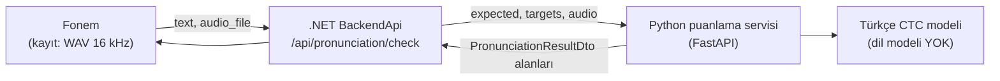

# Telaffuz Değerlendirme Altyapısı Araştırması

> **Tarih:** 2026-10-16 · **Bağlam:** [ROADMAP B31](../ROADMAP.md#10-fark-edilenler-backlog) (FluentMe API'si kapandı), [B16](../ROADMAP.md#10-fark-edilenler-backlog) (Whisper uzun kelimelerde 0 puan) · **Soru:** Konuşma sesi bozukluğu (KSB) yaşayan Türk çocukları için, beklenen kelimeyi ve çocuğun 1-5 sn'lik kaydını alıp **hedef sesin doğru üretilip üretilmediğini** söyleyen bir altyapı bugün var mı? Yoksa ne kurmalıyız?
>
> Kaynaklar sonda. **[Doğrulanmadı]** etiketli maddeler tahmin ya da birincil kaynaktan teyit edilemeyen bilgidir.

---

## 1. Özet ve öneri

1. **Türkçe telaffuz değerlendirmesi yapan hazır bir ticari API hâlâ yok.** Azure (33 dil), SpeechSuper (8), Speechace (3), ELSA (yalnızca İngilizce), Tencent/iFlytek (Çince/İngilizce) Türkçeyi yalnızca konuşmayı yazıya dökme (ASR) için destekliyor, telaffuz puanlama için desteklemiyor. Azure'un resmî tablosunda `tr-TR` olmadığını tabloya bakarak kendim doğruladım (sayfa 2026-09-10'da güncellenmiş). Çocuk konuşmasına özel firmalar (SoapBox, Amira) yalnızca İngilizce ve İspanyolca destekliyor.
2. **FluentMe'nin geliştirici API'si tamamen kapandı.** Site Eylül 2026'da yalnızca İngilizce bir koçluk uygulamasına dönüştü. Arka planda Google STT ve Gemini kullanıyor.
3. **Ses anlayan büyük dil modelleri (GPT-4o-audio, Gemini, Qwen) bu iş için yeterli değil.** 2025-26 yayınlarında bu modeller çocuk konuşma patolojisinde F1 ≤ 0,56, telaffuz hatası tespitinde F1 ≈ 0,46 aldı; klinik eşik 0,80'in üzerinde. Ayrıca Whisper'daki "hatayı düzelterek yazma" sorunu bu modellerde de görülüyor.
4. **Yine de bugün çalışan, eğitim gerektirmeyen bir yol var: kısıtlı CTC puanlaması.** Türkçe için hazır bir CTC modelini **dil modeli olmadan** kullanırız. Bu model, kaydın beklenen kelimeye (`araba`) mı yoksa bilinen hatalı biçimlerine (`ayaba`, `alaba`, `aaba`) mı daha çok benzediğini olasılık olarak hesaplar. Model yalnızca bizim verdiğimiz adaylar arasında seçim yaptığı için hatayı "düzeltip" yazamaz. Akademide bu yöntem "substitution-aware GOP" olarak geçiyor (Interspeech 2025). Türkçe yazım sese çok yakın olduğu için Türkçe harf tabanlı bir model fonem tanıyıcı yerine kullanılabilir.
5. **Klinik güvenilirlik için zamanla kendi çocuk verimizi biriktirmemiz gerekiyor.** Büyük bir veri toplama çalışması şart değil; az veriyle ilerleme yolları için bkz. §4 "Az veriyle ilerleme". Bilinen bir Türkçe KSB veri seti ya da otomatik tespit çalışması yok. Bu, tez için **gerçek bir katkı alanı**. Benzer çalışmalar 95 çocukla (1,6 saat, Korece) ve 201 çocukla (Lehçe) dil-konuşma terapisti (DKT) yargısına yakın sonuç aldı.

**Önerim:** FluentMe'nin yerine başka bir ticari API aramayalım; aynı problemi yine dışarıdan çözemeyeceğiz. **Faz 0** olarak kısıtlı CTC puanlaması yapan küçük bir Python servisi kuralım. Böylece kelime ve cümle oyunları hemen tutarlı bir değerlendirmeye kavuşur. Ardından **Faz 1**'de DKT etiketli çocuk kayıtları toplayıp modeli çocuk sesine uyarlayalım. Hece oyunları Faz 0 doğrulanana kadar Whisper'da kalabilir.

---

## 2. Whisper neden bizim işimize uymuyor

- Whisper, içinde bir dil modeli taşıyan encoder-decoder bir model. Bu yüzden çıktıyı **gerçek bir kelimeye** doğru çeker. Çocuk "ayaba" dese bile "araba" yazabilir. Yani tam yakalamamız gereken hatayı gizler. Konuşması bozuk kişilerde Whisper'ın uydurma (halüsinasyon) oranı da artıyor (Careless Whisper, FAccT 2024).
- ASR doğruluğu (WER) arttıkça bu sorun azalmıyor, **büyüyor**: daha iyi model, hatayı daha başarılı düzeltir. Aynı gözlem L2-Arctic-plus (EACL 2026) ve K-Function (2026) çalışmalarında da var.
- Sonuç: Deepgram, AssemblyAI, ElevenLabs, Speechmatics ve Google Chirp gibi daha iyi Türkçe ASR servisleri **çözüm değil**.

---

## 3. Seçeneklerin karşılaştırması

### 3.1 Ticari telaffuz API'leri

| Servis | Türkçe telaffuz değerlendirmesi | Ayrıntı düzeyi | Çocuk | Not |
|---|---|---|---|---|
| Azure AI Speech – Pronunciation Assessment | ❌ (33 dil var, `tr-TR` yok; doğrulandı) | Fonem puanı; "hangi ses söylendi" bilgisi yalnızca en-US'de | Çocuk modeli yok | Saati 1 $, aylık 5 saat ücretsiz. Türkçe Custom Speech yalnızca ASR'yi uyarlıyor |
| SpeechSuper | ❌ (EN, ZH, DE, FR, ES, KO, JA, RU) | Fonem düzeyinde ekleme, silme ve yerine koyma | — | Çin merkezli |
| Speechace | ❌ (EN, ES, FR) | Fonem bazında, `sound_most_like` alanı var | K-12 odaklı | AB bölgesi var, sıfır saklama sözleşmeyle |
| ELSA, Language Confidence | ❌ (İngilizce) | — | — | Resmî dokümanları teyit edilemedi |
| Tencent SOE, iFlytek ISE | ❌ (Çince/İngilizce) | Fonem | Tencent: "çocuktan yetişkine" | Tencent'in uluslararası sayfası 404 **[Doğrulanmadı]** |
| Google, Amazon | Telaffuz değerlendirme ürünü yok | — | — | Yalnızca ASR |
| **thefluent.me** | **API kapandı** | — | — | Yalnızca İngilizce tüketici uygulaması (Eylül 2026) |
| SoapBox Labs, Amira | ❌ (EN, ES) | — | ✅ çocuk odaklı | Curriculum Associates bünyesinde, yalnızca kurumsal (B2B) |
| Türk firmaları | Bulunamadı | — | — | En yakın rakip E-Terapim (iOS, R/S/Z/L/K/T için "yapay zekâ" iddiası var, yöntemi ve doğrulaması yayımlanmamış) |

### 3.2 Ses anlayan büyük dil modelleri

| Kanıt | Sonuç |
|---|---|
| *The Sound of Syntax* (EMNLP 2025): 15 model, çocuk konuşma patolojisi | Tanıda en iyi micro-F1 0,556. Hiçbir model klinik eşiğe (≈0,80+) ulaşamadı. Örnek göstermek modeli **hedef kelimeyi yazmaya** itiyor. Ince ayar (fine-tuning) +%10'dan fazla kazandırıyor |
| *L2-Arctic-plus* (EACL 2026): yetişkin telaffuz hatası tespiti | GPT-4o-audio F1 46,3; Qwen2-Audio 28,8; Whisper + LLM zinciri 6-27 |
| GPT-4o ile çok düzeyli puanlama (2025) | Yazarlar LLM'i yerleşik yöntemlerle **birlikte** kullanmayı öneriyor, yerine değil |
| Türkçe | Türkçe çocuk konuşmasında LLM değerlendirmesi yapan yayın yok |

Bu modeller ana değerlendirici olamaz. En fazla, düşük güvenli durumlarda **ikinci görüş** olarak kullanılabilir. O durumda da hedef kelime modele gösterilmemeli; modelden önce IPA çevriyazısı istenmeli ve karşılaştırmayı kendi kodumuz yapmalı. Qwen3-Omni Türkçe ses girişini destekliyor ama 30B parametreli; kendi sunucumuzda çalıştırmak ağır. HF kartında lisans "other" görünüyor **[Lisans doğrulanmalı]**.

### 3.3 Açık kaynak, kendi sunucumuzda çalışabilecek modeller

| Model | Çıktı | Türkçe | Lisans | Boyut |
|---|---|---|---|---|
| `mpoyraz/wav2vec2-xls-r-300m-cv8-turkish` | Türkçe harf (CTC) | ✅ Yerel; CER 2,67 (Common Voice 8) | Apache-2.0 (doğrulandı) | 300M |
| `facebook/omniASR-CTC-300M` (Meta Omnilingual, Kasım 2025) | Harf (CTC) | 1600+ dil, Türkçe dahil **[Türkçe CER bulunamadı]** | Apache-2.0 (doğrulandı) | ~325M. Yalnızca CTC sürümü kullanılmalı; LLM çözücülü sürümleri yine "düzeltme" yapar |
| `facebook/wav2vec2-xlsr-53-espeak-cv-ft` | eSpeak fonemleri (CTC) | Eğitim dillerinden biri | Apache-2.0 | 300M |
| ZIPA (ACL 2025) | IPA fonları | 88 dil **[Türkçe teyit edilmedi]** | MIT / CC-BY-4.0 ("ns" sürümleri ticari kullanıma kapalı) | **64M**, ONNX INT8. CPU için en uygun aday |
| POWSM (2025) | Fon tanıma + ASR + G2P | **[Dil listesi yok]** | CC-BY-4.0 | 350M |
| Montreal Forced Aligner – Türkçe | Fonem hizalama | ✅ (yetişkin, HMM-GMM) | CC-BY-4.0 / CC-0 | Küçük. Çocuk sesinde zayıf **[Doğrulanmadı]** |
| Allosaurus | Evrensel fonlar (`--lang tur`) | ✅ | **GPL-3.0** | Küçük, eski |

### 3.4 Türkçe kaynaklar

- **PhonBank Turkish Istanbul Corpus** (doğrulandı): 2;0-7;11 yaş arası **120 tipik gelişen çocuk**, SST artikülasyon alt testindeki 93 kelime. Tüm ünsüzleri dört pozisyonda içeriyor; ses ve çevriyazı mevcut. Bozuk konuşma içermiyor, ama **yanlış alarm testi** için çok değerli. Kullanırken atıf gerekiyor (Biçer 2020); lisansı ayrıca kontrol edilmeli.
- **SST (Türkçe Artikülasyon ve Fonoloji Testi)** normları: 605 tipik ve 70 fonolojik bozukluğu olan çocuk. Ses kaydı değil, etiketlemede klinik referans olarak kullanılabilir.
- **Yetişkin Türkçe veri:** Common Voice Türkçe (135 saat, 1.816 konuşmacı, CC0) ve MediaSpeech (10 saat).
- **Türkçe çocuk KSB veri seti ya da otomatik tespit makalesi: bulunamadı.**

---

## 4. Önerilen mimari

- **Sözleşme değişmez.** Fonem bugün de `PronunciationResultDto` biçimindeki yanıtı okuyor (`score`, `passed`, `feedback_key`, `transcript`). Backend `/check` adresinin arkasındaki FluentMe çağrısını Python servisine çağrıyla değiştirir. Fonem tarafında yapılacak tek iş, kelime ve cümle oyunlarını yeniden `checkPronunciation`'a bağlamak.
- **Python servisi** `.NET`'ten ayrı çalışır, çünkü PyTorch/ONNX ekosistemi orada.

### Faz 0: Eğitimsiz, hemen yapılabilir

1. Gelen sesi 16 kHz mono'ya çevir ve baştaki/sondaki sessizliği kırp.
2. **Aday üretici:** Hedef kelimeden kural tabanlı hatalı varyantlar üret. Kurallar KSB listemizden gelir:
   - `r → y / l / ∅`
   - `s → ş / t`, `ş → s`
   - `k → t` (öne alma), `g → d`
   - `l → y`
   - ünsüz kümesi sadeleştirme, son ünsüzü düşürme
   - Bunlar DKT ile birlikte netleştirilecek.
3. Her adayın CTC olasılığını hesapla (`torch.nn.functional.ctc_loss` ya da `torchaudio.functional.forced_align`).
4. **Karar:**
   - Doğru biçim, en yakın hatalı adaydan δ farkla öndeyse → **doğru**.
   - Hatalı bir aday kazanırsa → **hangi sesin neyle değiştiği** (`feedback_key: substitution_r_y` gibi).
   - Fark çok küçükse ya da ses kötüyse → **"bir daha söyler misin?"** Lehçe çalışma da bu yaklaşımı kullanıyor.
5. Serbest CTC çıktısını da (açgözlü/greedy çözümleme) logla. Bu hem hata ayıklamaya hem de Faz 1 etiketlemesine yarar.
6. **Barındırma:** Render'ın ücretsiz katmanı (512 MB RAM, 0,1 CPU) 300M'lik bir modeli kaldırmaz. Seçenekler:
   - en az 2 GB RAM'li ücretli bir instance,
   - Hugging Face Spaces CPU **[ücretsiz limitler doğrulanmadı]**,
   - ZIPA-64M INT8 (512 MB'a sığabilir ama yavaş olur).
   - Gecikme tahmini: 3 sn'lik kayıt, 2 vCPU'da 0,5-2 sn **[ölçülmeli]**.

**Faz 0 neyi sağlar, neyi sağlamaz:** Oyun içinde "tekrar dene" ya da "harika!" geri bildirimi için yeterli olması beklenir. Klinik bir yargı için yeterli değil; 3-6 yaş çocuk sesi, yetişkin verisiyle eğitilmiş modeller için zor.

### Faz 1: Veri toplama ve çocuk sesine uyarlama

- **Kelime listesi:** Oyundaki kelimeler. 30-60 kelime; /r/, /s/, /ş/, /k/, /l/ seslerini başta, ortada ve sonda içerecek. SST'deki pozisyon mantığı örnek alınabilir.
- **Etik ve izin:** Etik kurul onayı ve ebeveynden açık rıza (bkz. §6).
- **Hedef:** **50-100 çocuk, toplam 1-3 saat.** Hem tipik gelişen hem KSB'li çocuklar olmalı. Korece çalışma 95 çocuk ve 1,6 saatle DKT'ye çok yakın sonuç aldı (PCC uyumunda ICC 0,98).
- **Etiketleme:** DKT her hedef sesi şöyle işaretler: doğru / yerine koyma (hangi sesle) / atlama. Kayıtların **%20'sini ikinci bir DKT** etiketler; böylece insanlar arası uyumu, yani ulaşılabilecek tavanı ölçeriz.
- **Model uyarlama:** CTC modeli LoRA ile çocuk verisine ince ayarlanır. Aşırı uyumu önlemek için Common Voice Türkçe ile karıştırılır. Sonraki adımda, ses başına küçük sınıflandırıcılar (posterior/GOP özellikleri üzerinde) eklenebilir; Hair ve ark. 2021'de bu yöntem düz GOP'u yaklaşık %10 geçmiş.

### Az veriyle ilerleme (50-100 çocuğa ulaşılamazsa)

> 2026-10-16 ekip notu: Şu aşamada bu kadar çocuğa ulaşmak mümkün değil. Bu bölüm, büyük bir veri toplama çalışması yapmadan ilerlemenin yollarını anlatır.

50-100 çocuk yalnızca **modeli çocuk sesine göre yeniden eğitmek** için gerekiyor. **Faz 0 hiç eğitim istemiyor.** Veriye yalnızca "ne kadar iyi çalışıyor?" sorusunu cevaplamak için ihtiyaç var, bunun için de çok daha az veri yeter.

1. **Hazır Türkçe çocuk verisi: PhonBank İstanbul.**
   - 2;0-7;11 yaş arası 120 çocuk, SST kelimeleri.
   - Sayfada parola ya da üyelik koşulu yok; kullanımda atıf zorunlu (Biçer 2020).
   - Çocuklar tipik gelişiyor, ama 2-4 yaş grubu doğal olarak gelişimsel ses değiştirmeleri yapar (ör. r→y).
   - PhonBank derlemeleri genellikle hedef IPA'nın yanında çocuğun **gerçek söyleyişini (IPA Actual)** de içerir. Bu derlemede olup olmadığı sayfada yazmıyor **[İndirip doğrulanmalı]**. Varsa, kimseye ulaşmadan hem doğru hem hatalı **gerçek Türkçe çocuk örnekleri** elde ederiz.
2. **Bilerek hatalı okunmuş kayıtlar.**
   - Ekip ve gönüllü yetişkinler aynı kelimeleri hem doğru hem bilerek hatalı okur ("ayaba", "tedi").
   - Telaffuz hatası araştırmalarında yapay hata üretme bilinen bir yöntemdir.
   - Perde ve formant kaydırma (vocal tract length perturbation) ile kayıtlar çocuk sesine yaklaştırılabilir; çocuk ASR çalışmalarında bilinen bir veri çoğaltma tekniğidir.
   - Sınırlama: gerçek çocuk değil. Ama sistemin r→y gibi zıtlıkları ayırt edip edemediğini birkaç saatte gösterir.
3. **Uygulamanın kendisini veri kaynağı yapmak (insan döngüde).**
   - Fonem zaten kayıt alıyor, panelde de terapistler var.
   - Panele, görev sonucu için tek tıklık bir **terapist onayı** eklenir: ✓ doğru / ✗ yanlış, varsa hangi sesle değiştirildiği.
   - Ayrı bir çalışma yürütmeden, gerçek kullanımdan, gerçek KSB'li çocuklardan etiketli veri birikir.
   - Ebeveyn rızası Fonem'in KVKK onay akışına eklenir (ROADMAP PR-24 ile birlikte).
   - Terapist onayıyla sistem kararı arasındaki uyum, ek bir çalışma yapmadan sürekli bir değerlendirme ölçüsü de olur.
4. **Küçük ama dürüst bir pilot.**
   - Tez için **5-10 çocuk ve bir DKT'nin etiketlemesi** yeterli bir pilot olur.
   - "Büyük ölçekli doğrulama gelecek çalışmadır" kabul edilir bir sınırlamadır; Lehçe ve Korece çalışmalar da pilotla başlamıştı.

**Önerilen sıra:**
1. Faz 0 prototipi.
2. PhonBank ve bilerek hatalı okunmuş kayıtlarla ilk ölçüm (yanlış alarm oranı + r→y, s→ş gibi zıtlıkların ayrımı).
3. Panelde terapist onayı ile veri döngüsü.
4. Biriken veriyle Faz 1 uyarlaması.

Hiçbir adım büyük bir çocuk toplama çalışmasına bağımlı değil.

### Değerlendirme (tez için)

- Eğitim ve test kümelerini **çocuk bazında** ayır, kayıt bazında değil.
- Her hedef ses için şunları raporla:
  - hata tespitinde kesinlik, duyarlılık ve F1;
  - **doğru üretimde yanlış alarm oranı** (çocuğun motivasyonu için en kritik sayı; Lehçe sistemde %2,7);
  - hangi sesin neyle değiştiğini gösteren karışıklık matrisi.
- Sistem-DKT Cohen κ değerini, iki DKT arasındaki κ değerinin yanında ver.
- Çocuk başına PCC (doğru ünsüz yüzdesi) için ICC hesapla.
- PhonBank İstanbul verisi ek bir "tipik çocuk" test kümesi olarak kullanılabilir.

---

## 5. Maliyet karşılaştırması (kabaca)

| Seçenek | Değişken maliyet | Sabit maliyet | Türkçe KSB'ye uygunluk |
|---|---|---|---|
| Whisper (bugünkü) | ~0,006 $/dk | — | ❌ Hataları gizliyor |
| Azure Pronunciation Assessment | 1 $/saat | — | ❌ Türkçe yok |
| GPT/Gemini ses modelleri | 3 sn'lik kayıt için çok düşük | — | ⚠️ Doğruluk yetersiz, belirlenimci değil |
| **Kendi CTC servisimiz** | ~0 | Barındırma (2 GB RAM'li bir instance) **[fiyat doğrulanmadı]** | ✅ Doğru tasarlanırsa |

---

## 6. KVKK ve etik

- Çocuğun terapi bağlamındaki ses kaydı büyük olasılıkla **sağlık verisi**, yani özel nitelikli kişisel veri sayılır. Bu yüzden **ebeveynin açık ve ispatlanabilir rızası** gerekir. KVKK'da çocuklara özel bir hüküm yok. (Hukuki görüş değildir.)
- **Yurt dışına aktarım** (7499 sayılı Kanun, 1 Haziran 2024'te yürürlüğe girdi): Sıralama yeterlilik kararı → standart sözleşme (imzadan sonra 5 iş günü içinde Kurul'a bildirim) → arızi istisnalar. ABD için yeterlilik kararı yok. Kurul rehberine göre ABD'deki bir API'nin **düzenli kullanımı "arızi" sayılmıyor**.
- Bugünkü durum: kayıtlar Cloudinary'de süresiz ve herkese açık URL'lerle duruyor; OpenAI'ye de gönderiliyor. Bu zaten bir risk (ARCHITECTURE §9, PR-24).
- **Kendi sunucumuzda çalışan bir model bu riskin büyük kısmını ortadan kaldırır.** Ses yurt dışındaki bir yapay zekâ sağlayıcısına gitmez; değerlendirmeden sonra hemen silinebilir. Bu, açık kaynak yolu için tezde savunulabilecek ayrı bir gerekçedir.
- Uygulama **teşhis aracı değil, pratik ve tarama geri bildirimi** olarak konumlanmalı. Lehçe ve Korece çalışmalar da böyle konumlanmış.

---

## 7. Açık sorular (ekip ve DKT ile)

1. Hedef sesler ve hata kuralları listesi (§4, Faz 0 adım 2). Hangi sesler, hangi yerine koymalar? Bunu DKT belirlemeli.
2. Çocuk kayıtlarını hangi kurumla, hangi etik kurul onayıyla toplayacağız?
3. Python servisini nerede barındıracağız (Render ücretli / HF Spaces / okul sunucusu)?
4. Hece oyunları Whisper'da mı kalacak, yoksa yeni hatta mı geçecek? Önerim: Faz 0 doğrulanınca hepsi yeni hatta.
5. Puanlamada `ş/s`, `ç/c`, `ı/i` ayrımı (ARCHITECTURE §12 soru 3). Yeni hatta bu ayrım **zorunlu**, çünkü tespit etmek istediğimiz hatalar tam olarak bunlar.

---

## Kaynaklar

**Ticari servisler**
- Azure dil desteği (Pronunciation assessment sekmesi): https://learn.microsoft.com/en-us/azure/ai-services/speech-service/language-support?tabs=pronunciation-assessment
- Azure Pronunciation Assessment rehberi: https://learn.microsoft.com/en-us/azure/ai-services/speech-service/how-to-pronunciation-assessment
- Azure veri gizliliği: https://learn.microsoft.com/en-us/azure/ai-foundry/responsible-ai/speech-service/speech-to-text/data-privacy-security
- SpeechSuper: https://www.speechsuper.com/ · https://github.com/speechsuper/SpeechSuper-API-Samples
- Speechace: https://api-docs.speechace.com
- Tencent SOE: https://cloud.tencent.com/document/product/1774/107338
- thefluent.me: https://thefluent.me
- SoapBox Labs satın alma: https://soapboxlabs.com/blog/soapbox-labs-acquired-by-curriculum-associates
- E-Terapim: https://apps.apple.com/app/id6757763212

**LLM değerlendirmeleri**
- The Sound of Syntax (EMNLP 2025): https://arxiv.org/abs/2509.16765
- L2-Arctic-plus / Unlocking LALMs for Interactive Language Learning (EACL 2026): https://arxiv.org/abs/2601.14744
- GPT-4o çok düzeyli telaffuz puanlama: https://arxiv.org/abs/2503.11229
- K-Function: https://arxiv.org/abs/2507.03043
- Careless Whisper (FAccT 2024): https://arxiv.org/abs/2402.08021
- Qwen3-Omni: https://huggingface.co/Qwen/Qwen3-Omni-30B-A3B-Instruct

**Yöntem ve çocuk konuşması**
- Substitution-aware GOP (Interspeech 2025): https://arxiv.org/abs/2506.02080
- Segmentation-free GOP: https://arxiv.org/abs/2507.16838
- NOCASA 2025 (Norveççe, çocuk): https://arxiv.org/abs/2509.03256
- Lehçe çocuk KSB taraması (Interspeech 2026): https://arxiv.org/abs/2606.25181
- Korece çocuk KSB (JMIR 2025): https://pmc.ncbi.nlm.nih.gov/articles/PMC11775490/
- Hair ve ark. (Interspeech 2021): https://www.isca-archive.org/interspeech_2021/hair21_interspeech.html
- Marx ve ark. (Interspeech 2025): https://www.isca-archive.org/interspeech_2025/marx25_interspeech.html
- Çocuk ASR, wav2vec2 ve Whisper karşılaştırması: https://arxiv.org/abs/2307.13008

**Modeller ve veri**
- mpoyraz Türkçe XLS-R: https://github.com/mpoyraz/wav2vec2-turkish
- Meta Omnilingual ASR: https://huggingface.co/facebook/omniASR-CTC-300M
- ZIPA: https://github.com/lingjzhu/zipa
- POWSM: https://huggingface.co/espnet/powsm
- Montreal Forced Aligner Türkçe modeli: https://mfa-models.readthedocs.io/en/latest/acoustic/Turkish/index.html
- PhonBank Turkish Istanbul: https://talkbank.org/phon/access/Other/Turkish/Istanbul.html
- SST: https://avesis.anadolu.edu.tr/yayin/b620549e-b388-47ec-8857-f886ce5b37d4/turkish-articulation-and-phonology-test-sst-validity-reliability-and-standardization
- Common Voice Türkçe: https://datacollective.mozillafoundation.org/datasets/cmn2e7kbl01k2mm07gm5n1bc9

**KVKK**
- Yurt dışı aktarım rehberi: https://www.erdem-erdem.av.tr/bilgi-bankasi/yurt-disina-kisisel-veri-aktarimi-rehberi-neleri-duzenliyor
- Özel nitelikli veri değişiklikleri: https://www.hukukihaber.net/kvk-kanununda-ozel-nitelikli-kisisel-verilerin-islenmesi-ve-yurt-disina-veri-aktarimi-kapsaminda-yapilan-degisikliklere-iliskin-degerlendirmeler
- OpenAI veri saklama: https://developers.openai.com/api/docs/guides/your-data

**Bu çalışmada doğrulanamayanlar:** iFlytek dil listesi; Tencent'in uluslararası durumu; ELSA ve Language Confidence resmî dokümanları; Speechace fiyatları; Omnilingual ve ZIPA'nın Türkçe hata oranları; CPU gecikme sayıları; HF Spaces limitleri; E-Terapim'in puanlama yöntemi; Qwen3-Omni lisansı.
